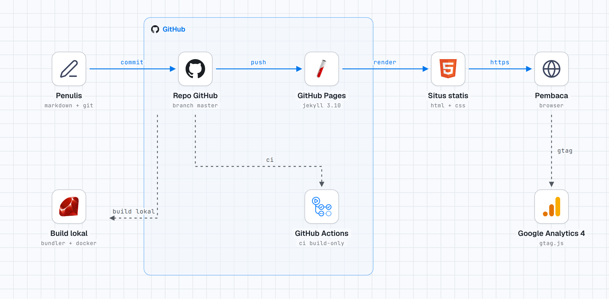

# yogiex.github.io

[](LICENSE)
[](https://jekyllrb.com/)
[](https://www.ruby-lang.org/)
[](https://pages.github.com/)
[](https://github.com/yogiex/yogiex.github.io/actions/workflows/build.yml)

> Personal blog of **Priyagung Yogi** — notes on digital forensics, computer
> networking, Linux, containers, and CTF. A static Jekyll site published
> directly from `master` via GitHub Pages, with no database and no application
> server.

**Live:** [yogiex.github.io](https://yogiex.github.io) · **Content language:** Indonesian

## Contents

- [Highlights](#highlights)
- [Tech stack](#tech-stack)
- [Architecture](#architecture)
- [Getting started](#getting-started)
- [Project structure](#project-structure)
- [Writing a post](#writing-a-post)
- [Contributing](#contributing)
- [License](#license)
- [Acknowledgments](#acknowledgments)

## Highlights

- Articles on networking, Linux, containers, and CTF, written in Indonesian.
- Customized fork of [Beautiful Jekyll](https://github.com/daattali/beautiful-jekyll), with SEO and accessibility improvements (meta descriptions, Open Graph, JSON-LD, sitemap, `lang="id"`, keyboard-friendly navigation).
- Reproducible local build: `Gemfile` pins `github-pages ~> 233` (Jekyll 3.10) and a `ruby:3.2` Docker image mirrors production.
- Build-only CI (`.github/workflows/build.yml`) runs `jekyll build --strict_front_matter` plus four HTML checks.
- Google Analytics 4, RSS feed, and tag index out of the box.

## Tech stack

| Layer | Technology | Notes |
|---|---|---|
| Content | Markdown + YAML front matter | One file per post in `_posts/`, named `YYYY-MM-DD-slug.md` |
| Generator | Jekyll 3.10.0 | Pinned via `gem "github-pages", "~> 233"` |
| Templating | Liquid | Layouts in `_layouts/`, partials in `_includes/` |
| Theme | Fork of Beautiful Jekyll | 2016-2018 generation, heavily modified; MIT license, footer credit retained |
| Styling | Bootstrap 3 + custom CSS | `css/main.css` is processed by Liquid (colors from `_config.yml`); Font Awesome 4.6 and Google Fonts from CDN |
| Interaction | jQuery 1.11.2 + Bootstrap 3 JS | `js/main.js` for navbar and header image; no JS bundler |
| Plugins | `jekyll-paginate`, `jekyll-sitemap` | 5 posts per page; RSS is hand-written in `feed.xml` |
| Build & hosting | GitHub Pages | Native build from `master`, no staging environment |
| CI | GitHub Actions | Build-only, green: `jekyll build --strict_front_matter` plus four HTML checks |
| Local preview | Bundler + Docker | Image `ruby:3.2`, same gems as production |
| Analytics | Google Analytics 4 | `gtag.js` in `_includes/analytics.html`, loaded from `head.html` |
| Permalink | `/:year-:month-:day-:title/` | Single-segment URL, e.g. `/2025-12-25-etherchannel-networks/` |

## Architecture

<picture>
  <source media="(prefers-color-scheme: dark)" srcset="diagrams/yogiex-stack-dark.png">
  
</picture>

Blue lines are the publish path; dashed lines are development and measurement. Source: `diagrams/yogiex-stack.html` (self-contained, with a dark-mode toggle).

Every push to `master` goes straight to production. There is no staging environment, so risky changes should be previewed locally first.

## Getting started

### Prerequisites

- Docker (recommended), or Ruby 3.2 with Bundler 2.4.

### Run locally

```bash
docker build -t yogiex-preview .
docker run --rm -p 4000:4000 -v "$PWD:/srv/jekyll" yogiex-preview
```

Open <http://localhost:4000>. Without Docker:

```bash
bundle install
bundle exec jekyll serve
```

`Gemfile.lock` only ships the `x86_64-linux` platform. On Apple Silicon, add the platform first:

```bash
bundle lock --add-platform arm64-darwin && bundle install
```

### Validate the build

```bash
bundle exec jekyll build --strict_front_matter --trace
```

This command passes from `HEAD` as of November 2026, both with the cached gems and a clean `bundle install`.

## Project structure

```text
_config.yml        Site config: navigation, colors, analytics, permalink
index.html         Post list + paginator
aboutme.md         Profile page
tags.html          Tag index
404.html           404 page
feed.xml           Hand-written RSS
_layouts/          HTML shells (base, page, post, default)
_includes/         Template partials (head, nav, header, footer, analytics)
_posts/            Markdown articles
img/               Article images, grouped by topic
css/ js/           Styles and interaction
.github/workflows/ Build-only CI
diagrams/          Architecture diagram (HTML + PNG, excluded from build)
```

Detailed conventions live in [AGENTS.md](AGENTS.md).

## Writing a post

Short version of the rules:

- `subtitle` of 80-160 characters becomes the `<meta name="description">`.
- Images use absolute paths `/img/<topic>/file.png`; no hotlinks.
- Body headings start at `##`; the page header already produces the `<h1>`.
- `bigimg` is an array; remove the key entirely when there is no header image.
- File dates must not be in the future.

Full writing standard (structure, tone, code blocks, images, SEO, editorial checklist) is in [AGENTS.md](AGENTS.md).

## Contributing

This is a personal blog, but fixes and suggestions are welcome:

1. Fork and create a branch.
2. Preview locally with the Docker command above.
3. Keep changes small and focused; do not reformat unrelated files.
4. Open a pull request describing what changed and why.

Do not push directly to `master` without previewing first — every push becomes production.

## License

Two scopes, two terms:

- **Code and theme** — based on [Beautiful Jekyll](https://github.com/daattali/beautiful-jekyll) by Dean Attali, MIT license. Applies to layouts, includes, CSS, and JavaScript. Full text in [LICENSE](LICENSE).
- **Writing** — all article text in `_posts/` and the profile page is copyright Priyagung Yogi. Not covered by the MIT license; contact the author before large-scale reuse. Short quotes with a link back are fine.

## Acknowledgments

- [Dean Attali](https://github.com/daattali) for Beautiful Jekyll.
- [Jekyll](https://jekyllrb.com/) and [GitHub Pages](https://pages.github.com/) for the build and hosting.