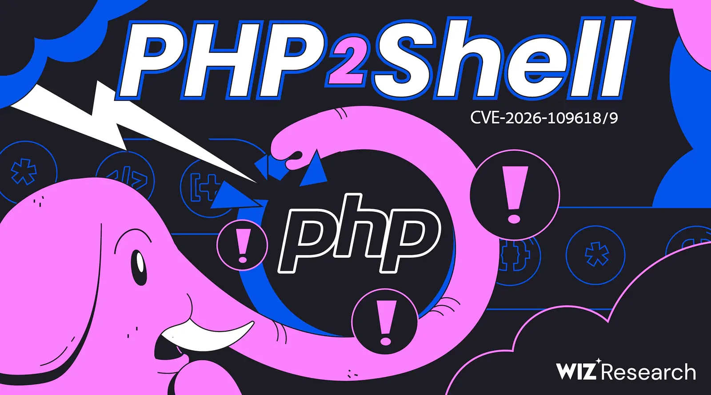

> **Ringkasan:** PHP2Shell adalah keluarga celah *memory safety* di core PHP yang dikelompokkan ke dalam dua CVE (*Common Vulnerabilities and Exposures*) dan dapat berujung pada *remote code execution* (RCE) tanpa autentikasi. Celahnya ada di runtime PHP, bukan di WordPress atau framework. Patch sudah tersedia; artikel ini membahas cara memeriksa, menambal, dan mendeteksi eksploitasinya.

Pada 21 Oktober 2026, PHP (*PHP: Hypertext Preprocessor*) merilis pembaruan keamanan untuk dua celah yang kemudian dikenal sebagai **PHP2Shell**. Yang membuat saya tertarik bukan hanya skor CVSS (*Common Vulnerability Scoring System*) 4.0-nya yang mencapai 9.2, tetapi posisi bugnya: di core PHP itu sendiri. Artinya, memperbarui WordPress, Laravel, atau aplikasi lain belum tentu menambal masalahnya.

Saya sengaja tidak menulis langkah eksploitasi atau menyertakan *proof of concept* (PoC). Fokus artikel ini adalah memahami risikonya dan melakukan langkah defensif yang bisa dipertanggungjawabkan.

> **Yang perlu dilakukan sekarang:**
>
> 1. Cek versi PHP di setiap SAPI (cara PHP dipasang di web server) dan container.
> 2. Patch ke 8.2.35, 8.3.36, 8.4.27, atau 8.5.12, lalu restart worker (proses PHP).
> 3. Jika belum bisa patch, terapkan mitigasi sementara dan pantau log.

Status eksploitasi dan angka dalam artikel ini per **9 November 2026**.

## Daftar isi

- [Apa itu PHP2Shell](#apa-itu-php2shell)
- [Kenapa aplikasi yang aman tetap bisa terdampak](#kenapa-aplikasi-yang-aman-tetap-bisa-terdampak)
- [Cara kerja PHP2Shell](#cara-kerja-php2shell)
- [Siapa yang berisiko](#siapa-yang-berisiko)
- [Apakah ini Log4Shell kedua](#apakah-ini-log4shell-kedua)
- [Cek versi PHP di server Anda](#cek-versi-php-di-server-anda)
- [Cara menambal dan memverifikasi](#cara-menambal-dan-memverifikasi)
- [Mitigasi sementara jika belum bisa patch](#mitigasi-sementara-jika-belum-bisa-patch)
- [Cara mendeteksi eksploitasi](#cara-mendeteksi-eksploitasi)
- [Jika Anda mencurigai kompromi](#jika-anda-mencurigai-kompromi)
- [Pelajaran dari PHP2Shell](#pelajaran-dari-php2shell)
- [Kesimpulan](#kesimpulan)

## Apa itu PHP2Shell

PHP2Shell bukan nama satu bug. Ini nama keluarga celah yang terdiri dari dua CVE:

| CVE | Akar masalah dan dampak |
|---|---|
| `CVE-2026-109618` | Penanganan *out-of-memory* (OOM) yang menginterupsi request di tengah inisialisasi; dapat berujung pada RCE dan pembacaan memori worker. |
| `CVE-2026-109619` | State global yang masih menunjuk ke memori request lama; dapat berujung pada RCE melalui *use-after-free*. |

Keduanya mendapat skor CVSS 4.0 **9.2 (kritis)**. Vektor CVSS-nya mencantumkan `AC:H` (*Attack Complexity: High*), yang berarti dampaknya besar tetapi eksploitasi tidak selalu sederhana.

Nama PHP2Shell berasal dari *exploit script* yang dibuat Wiz Research untuk menggabungkan beberapa jalur serangan. Wiz mendemonstrasikan eksekusi kode tanpa autentikasi pada WordPress, Drupal, dan Joomla. Namun, menurut Wiz, aplikasi tersebut hanya target demonstrasi. Celahnya tetap berada di PHP, sehingga aplikasi sederhana seperti “Hello World” pun bisa terdampak jika runtime-nya rentan.



*Gambar 1. Ilustrasi PHP2Shell dari Wiz Research (© Wiz Research). Sumber: [Wiz Research — PHP2Shell](https://www.wiz.io/blog/php2shell-php-rce), diakses 9 November 2026.*

Keluarga PHP2Shell mencakup varian yang memengaruhi PHP sejak versi 5.4. Jalur eksploitasi yang tersedia berbeda-beda tergantung versi PHP dan SAPI (*Server Application Programming Interface*) yang dipakai. Versi yang sudah diperbaiki adalah:

| Cabang | Versi rentan | Versi aman |
|---|---|---|
| PHP 8.2 | < 8.2.35 | 8.2.35 |
| PHP 8.3 | < 8.3.36 | 8.3.36 |
| PHP 8.4 | < 8.4.27 | 8.4.27 |
| PHP 8.5 | < 8.5.12 | 8.5.12 |

## Kenapa aplikasi yang aman tetap bisa terdampak

PHP memproses request dalam beberapa fase: startup, parsing input, eksekusi kode aplikasi, lalu shutdown. PHP2Shell menyentuh fase startup dan cleanup, sebelum atau sesudah kode aplikasi berjalan.

Bayangkan sebuah papan tulis di dapur restoran. Pesanan pertama ditulis, lalu listrik mati sebelum pesanan itu selesai dicatat. Papan tidak dibersihkan dengan benar. Ketika pesanan berikutnya datang, juru masak membaca sisa catatan lama sebagai pesanan yang masih aktif. Di PHP, “catatan lama” itu adalah state internal yang menunjuk ke memori yang sudah dibebaskan.

Pada `CVE-2026-109618`, OOM menginterupsi inisialisasi request. Pada `CVE-2026-109619`, fatal error meninggalkan state global yang menunjuk ke request lama.

Dua hal membuat masalah ini serius:

1. **Berada di bawah lapisan aplikasi.** Kode WordPress, Drupal, atau Laravel tidak perlu memiliki kerentanan sendiri. Selama PHP-nya rentan, permukaan serangannya tetap ada.
2. **Worker dipakai ulang.** Apache dengan `mod_php` (modul PHP di Apache) dan PHP-FPM (*FastCGI Process Manager*) dapat memakai kembali proses worker. Inilah yang memungkinkan state dari request lama bertemu request baru.

Ada juga dampak yang sering terlewat: **pembacaan isi memori**. Salah satu jalur yang didemonstrasikan memanfaatkan cookie `PHPSESSID` untuk mengembalikan sebagian memori worker ke klien. Memori itu bisa berisi password, token sesi, kunci API (*Application Programming Interface*), atau sertifikat dari request lain. Pembacaan memori bisa terjadi tanpa RCE, sehingga aktivitasnya lebih sulit terdeteksi.

## Cara kerja PHP2Shell

Bagian ini menjelaskan mekanismenya secara konseptual, dari tekanan memori sampai eksekusi kode.

### Memaksa PHP gagal di titik yang tepat

PHP membatasi memori request dengan `memory_limit`. Saat batas itu terlampaui, PHP tidak selalu melakukan *unwinding* seperti exception biasa. Ia memakai `longjmp()` untuk keluar dari konteks request; jalur ini menyelamatkan worker, tetapi melewati sebagian cleanup.

Penyerang tidak sekadar membuat server kehabisan memori. Ia mengirim request multipart yang membuat PHP mengalokasikan banyak struktur internal. Alokasi berikutnya kemudian gagal pada momen yang dipilih. Salah satu caranya adalah memanfaatkan field upload kosong dan struktur nama field bersarang: PHP tetap membuat entri `$_FILES` dan struktur hash untuk setiap field, bahkan ketika tidak ada file yang benar-benar diunggah. Saya tidak menuliskan bentuk payload-nya di sini.

Tujuannya: fatal terjadi setelah sebagian state internal “dipublikasikan”, tetapi sebelum cleanup selesai.

### Cleanup yang terpotong

Ketika fatal terjadi, sebagian pointer global masih menunjuk ke memori request. Request heap kemudian dibebaskan, tetapi proses worker tidak selalu ikut mati. Di Apache `mod_php`, worker dapat melayani request berikutnya. Di PHP-FPM, jalur startup yang gagal biasanya membuat worker keluar. Karena itu, varian FPM membutuhkan fatal yang terjadi setelah startup, misalnya saat aplikasi melakukan decoding.

Hasilnya adalah *use-after-free*: pointer yang seharusnya sudah tidak valid masih dianggap hidup.

### Request berikutnya mewarisi state

Request B yang dilayani worker yang sama dapat menempati memori yang baru dibebaskan. PHP lalu membaca isi memori itu sebagai struktur internal yang valid: bucket hash table, session ID, *bookkeeping* unserializer, atau metadata OPcache (*Opcode Cache*).

Karena penyerang bisa mengisi ulang memori tersebut lewat request, ia bisa membuat PHP membaca pointer atau tipe data yang salah. Di sinilah bug *memory safety* berubah menjadi primitif yang bisa dikendalikan.

### Dari korupsi memori ke RCE

Ada dua primitif yang saling melengkapi:

1. **Pembacaan memori.** Salah satu jalur yang didemonstrasikan membawa sebagian isi memori worker ke cookie `PHPSESSID`. Memori itu bisa berisi pointer, token, atau kredensial. Kebocoran pointer membantu penyerang melewati ASLR (*Address Space Layout Randomization*).
2. **Korupsi memori.** State internal yang sudah dibebaskan dapat dipakai untuk menulis atau mengarahkan pointer. Jika penyerang berhasil mengendalikan alur eksekusi, kode berjalan dengan hak user web server.

Wiz dan Calif mendemonstrasikan beberapa varian: bucket hash table yang belum selesai diinisialisasi, session upload progress, backtrace fatal error, dan *type confusion* di OPcache. Pemetaan varian ke CVE tidak selalu satu-ke-satu; satu CVE dapat mencakup beberapa bug dengan jalur eksploitasi berbeda. Semuanya berakar pada pola yang sama: **state dipublikasikan, lalu pekerjaan yang bisa gagal dilakukan, lalu cleanup yang seharusnya mengembalikan state dilewati.**

### Kenapa ini bisa terjadi sebelum autentikasi

Sebagian besar jalur berada di fase request startup atau cleanup, sebelum kode aplikasi berjalan. Karena itu, login, plugin, atau framework tidak menjadi penghalang utama. Namun, eksploitasi praktis tetap bergantung pada versi PHP, SAPI, konfigurasi, dan kemampuan penyerang mengatur memori. Inilah yang membuat PHP2Shell bukan “satu request untuk semua server”, tetapi tetap sangat serius.

| Tahap | Yang terjadi |
|---|---|
| 1. Tekanan memori | Request multipart memaksa PHP mendekati `memory_limit`. |
| 2. Fatal | `longjmp()` keluar dari konteks; cleanup tidak selesai. |
| 3. Heap dibebaskan | Pointer global masih menunjuk ke memori request lama. |
| 4. Worker dipakai ulang | Request berikutnya menempati memori itu. |
| 5. State palsu | PHP membaca pointer atau tipe yang dikendalikan penyerang. |
| 6. Dampak | Memori bocor atau alur eksekusi dibajak; RCE. |

> **Catatan:** Bagian ini sengaja tidak memuat payload, offset, atau langkah *heap grooming*. Tujuannya agar pembaca memahami akar masalah dan bisa menilai patch serta mitigasi, bukan menyalin eksploit.

## Siapa yang berisiko

Instalasi PHP yang masih menjalankan versi rentan dan melayani request web berisiko, termasuk:

- Apache dengan `mod_php`
- PHP-FPM
- `php-cgi`
- FrankenPHP
- LiteSpeed

PHP menyebut `mod_php` sebagai konfigurasi dengan risiko tertinggi karena serangan bisa terjadi sebelum kode aplikasi berjalan.

Risikonya tidak berhenti di website. PHP juga tertanam di container, panel hosting, appliance, dan produk pihak ketiga. Per 4 November 2026, [NCSC-NL (*National Cyber Security Centre Netherlands*)](https://github.com/NCSC-NL/php2shell) melacak 948 produk yang memiliki dependensi PHP; 215 di antaranya berstatus rentan dan 185 sudah diperbaiki. Artinya, inventarisasi tidak cukup dengan bertanya “apakah saya punya website PHP?”

Jika Anda memakai shared hosting, cPanel, atau Plesk, tanyakan versi PHP dan status patch ke provider. Anda mungkin tidak bisa memperbarui runtime itu sendiri.

Angka yang sering dikutip:

- Sekitar **70% situs web** menggunakan PHP, menurut [Wiz Research](https://www.wiz.io/blog/php2shell-php-rce).
- [Unit 42 (Palo Alto Networks)](https://unit42.paloaltonetworks.com/cve-2026-109618-cve-2026-109619/) memperkirakan ada **22,6 juta instance** yang terpapar berdasarkan telemetri mereka.

Angka pertama menggambarkan luas ekosistem. Angka kedua adalah estimasi paparan, bukan jumlah server yang sudah pasti bisa dieksploitasi.

Satu hal lagi: **PHP 8.2 mencapai akhir masa dukungan pada 31 Desember 2026**. Jika Anda masih di 8.2, patch ini bisa menjadi alasan yang baik untuk merencanakan upgrade ke 8.3 atau 8.4. PHP 8.1 dan yang lebih lama sudah tidak mendapat patch resmi; sebagian vendor menyediakan backport, tetapi tidak semuanya. Cek [PHP supported versions](https://www.php.net/supported-versions.php) untuk status terbaru.

## Apakah ini Log4Shell kedua

Ada kemiripan: celahnya berada di komponen yang dipakai sangat luas, bisa dieksploitasi tanpa autentikasi, dan sudah masuk [CISA (*Cybersecurity and Infrastructure Security Agency*) Known Exploited Vulnerabilities (KEV)](https://www.cisa.gov/known-exploited-vulnerabilities-catalog?field_cve=CVE-2026-109618) pada 26 Oktober 2026.

CISA memasukkan kedua CVE ke KEV, dan Unit 42 melaporkan eksploitasi aktif. Unit 42 mengutip laporan Dream Research tentang serangan terhadap management interface PAN-OS (*Palo Alto Networks OS*) yang terbuka ke internet, yang dirangkai dengan eskalasi hak akses Linux. Cisco Talos melihat upaya eksploitasi dalam hitungan jam setelah disclosure.

Tapi ada perbedaan penting. [Sansec](https://sansec.io/research/php2shell) menilai eksploitasi massal seperti Log4Shell tidak serta-merta terjadi. Banyak PoC publik membutuhkan kondisi tambahan, misalnya aplikasi target memiliki celah *local file inclusion* (LFI). Sebagian PoC bahkan hanya berhasil karena peneliti menambahkan kondisi tersebut ke server uji.

Jadi, cara membacanya:

- **Dampak tinggi:** celah ada di core PHP dan bisa memberi eksekusi kode.
- **Eksploitasi nyata:** sudah ada, terutama pada target terarah dan sistem yang terpapar.
- **Bukan satu request universal:** kondisi versi, SAPI, konfigurasi, dan aplikasi tetap berpengaruh.

Perbedaan ini bukan alasan untuk menunda patch. Justru sebaliknya: semakin banyak detail publik, semakin banyak aktor yang bisa mencoba. Status eksploitasi berubah cepat, jadi klaim di bagian ini berlaku per 9 November 2026.

## Cek versi PHP di server Anda

Langkah pertama adalah mengetahui runtime apa yang benar-benar melayani request. Jangan hanya mengecek satu binary di host.

```bash
php -v
php -i | grep -E \
  'Server API|Loaded Configuration File'
php-fpm -v
```

Jika `php` tidak ada, server mungkin hanya memakai `mod_php`. Periksa juga proses yang berjalan:

```bash
pgrep -a php
pgrep -a apache
pgrep -a lsphp
pgrep -a frankenphp
```

Untuk `mod_php`, `php -v` di shell bisa menampilkan versi CLI (*Command Line Interface*) yang berbeda. Cek modul Apache yang aktif dengan `apache2ctl -M | grep php` atau `phpinfo()` yang dilayani web server.

Untuk instalasi berbasis paket, termasuk RHEL (*Red Hat Enterprise Linux*) dan turunannya:

```bash
# Debian/Ubuntu
dpkg -l | grep '^ii  php' \
  | awk '{print $2, $3}'

# RHEL/AlmaLinux/Rocky Linux
rpm -qa | grep '^php' | sort
```

Untuk container, cek di dalam container, bukan di host:


```bash
docker ps --format \
  'table {{.Names}}\t{{.Image}}'
docker exec <nama-container> php -v
```


Container memiliki runtime sendiri. Memperbarui PHP di host tidak otomatis memperbarui PHP di dalam image. Prinsip ini juga berlaku saat Anda membangun image sendiri; lihat catatan [dasar Docker](/2020-09-20-belajar-docker/) kalau perlu.

Yang perlu dicatat adalah versi per SAPI. CLI dan PHP-FPM bisa memakai binary atau konfigurasi yang berbeda. Jika Anda hanya mengecek `php -v` di shell, belum tentu itu versi yang dipakai Apache atau FPM.

## Cara menambal dan memverifikasi

Patch adalah satu-satunya perbaikan lengkap. Prioritaskan sistem yang menghadap internet, lalu sistem internal yang memproses data sensitif.

Untuk instalasi dari paket distribusi, perbarui seluruh paket PHP yang terpasang, bukan hanya `php-cli`. Contoh di Debian/Ubuntu (nama paket dan versi menyesuaikan sistem Anda):

```bash
sudo apt update
sudo apt install --only-upgrade \
  php8.3-cli php8.3-fpm php8.3-common
sudo systemctl restart php8.3-fpm
sudo systemctl restart apache2
```

Contoh di atas hanya menyebut tiga paket. Jika ada ekstensi seperti `php8.3-mysql`, `php8.3-curl`, atau `php8.3-xml`, pastikan semuanya ikut diperbarui.

Untuk RHEL dan turunannya, gunakan `dnf update` pada paket PHP yang relevan. Jika memakai repo Remi, periksa apakah paket untuk cabang Anda sudah tersedia; [CERT-EU (*Computer Emergency Response Team for the EU*)](https://cert.europa.eu/publications/security-advisories/2026-018/) mencatat bahwa repo tersebut tidak mendapat update pada hari rilis.

Setelah patch:

```bash
php -v
php-fpm -v
```

Pastikan versi yang tampil sudah memenuhi batas minimum. Untuk verifikasi lebih kuat, cek changelog paket:

```bash
cd /usr/share/doc/php8.3-common
zgrep CVE-2026-109618 \
  changelog.Debian.gz
```

Di container, jangan menambal file di dalam container yang sedang berjalan. Rebuild image dari base image yang sudah diperbaiki, lalu deploy ulang. Jika Anda memakai image aplikasi yang membundel PHP sendiri, tunggu atau minta vendor merilis image baru. Memperbarui aplikasi saja tidak memperbarui runtime.

Untuk PHP 8.1 dan yang lebih lama, tidak ada build resmi baru. PHP menyediakan backport source untuk 7.4, 8.0, dan 8.1, sementara sebagian distributor menyediakan paket backport. Jika opsi itu tidak tersedia, upgrade ke cabang yang masih didukung adalah jalur yang lebih aman.

## Mitigasi sementara jika belum bisa patch

Tidak ada mitigasi yang menggantikan patch. Semua langkah di bawah ini hanya mengurangi paparan terhadap jalur tertentu.

- **Matikan session upload progress.** Set `session.upload_progress.enabled=0` di `php.ini` atau FPM pool, lalu restart worker. Jangan mengandalkan `ini_set()` atau `.user.ini`. *Risiko:* fitur progres upload bisa terganggu.
- **`memory_limit=-1` lewat `php_admin_value`.** Menghilangkan pemicu OOM yang bisa dikendalikan. *Risiko:* pemakaian memori tidak dibatasi; gunakan cgroup.
- **`post_max_size` kecil, misalnya `8M` atau `32M`.** Mengurangi tekanan memori dari request besar. *Risiko:* upload file besar bisa gagal.
- **Blokir `multipart/form-data` di reverse proxy.** Menghalangi salah satu bentuk trigger yang dikenal. *Risiko:* upload file dan sebagian form checkout bisa rusak.
- **Aturan WAF (Web Application Firewall).** Mengurangi pola serangan yang sudah dikenal, termasuk aturan terkelola dari [Microsoft Azure](https://techcommunity.microsoft.com/blog/azurenetworksecurityblog/addressing-php2shell-cve-2026-109618-and-cve-2026-109619-upgrade-guidance-and-az/4566623). *Risiko:* tidak lengkap dan rawan false positive.
- **Isolasi dari internet.** Menghentikan paparan sementara. *Risiko:* downtime dan gangguan layanan.

Beberapa catatan penting:

- **Jangan memakai `RLIMIT_AS` atau `RLIMIT_DATA`** sebagai pengganti `memory_limit`. PHP memperingatkan bahwa keduanya bisa memicu jalur kegagalan yang sama.
- **`memory_limit=-1` bukan tanpa risiko.** Satu request bisa menghabiskan memori server. Batasi dengan cgroup atau mekanisme OS (*Operating System*) lain, dan pantau penggunaannya.
- **Blokir multipart bisa merusak aplikasi.** Uji upload dan checkout di staging sebelum menerapkannya di produksi.
- **WAF bukan pengganti patch.** Beberapa vendor menambahkan inspeksi sisi response karena sinyal request saja tidak selalu cukup.

> **Catatan pasca-patch:** Pada 23 Oktober 2026, PHP mengungkap `CVE-2026-115560`, varian tambahan dengan kombinasi konfigurasi tidak umum. Aplikasi harus menyetel `session.serialize_handler` ke `php_binary` atau `php_serialize`, lalu mengubahnya ke `php` saat runtime sebelum `session_start()`. Session upload progress juga harus aktif. Per 9 November 2026, PHP menyarankan `session.upload_progress.enabled=0` sampai rilis bugfix berikutnya. Ini bukan alasan menunda patch, tetapi alasan untuk tidak langsung menganggap semua risiko hilang setelah update.

## Cara mendeteksi eksploitasi

Sinyal yang perlu dicurigai, terutama pada server PHP yang menghadap internet:

- Request `multipart/form-data` yang tidak wajar, lalu diikuti error `memory_limit` atau HTTP (*Hypertext Transfer Protocol*) 500 berulang.
- Cookie `PHPSESSID` pada response yang ukurannya tidak normal, sangat besar, atau berisi data ter-*encode* yang aneh.
- Worker PHP yang sering mati, restart, atau berganti tanpa penjelasan.
- Proses anak dari worker PHP yang menjalankan shell, `curl`, `wget`, atau perintah sistem lain.
- Koneksi keluar dari proses PHP ke host yang tidak dikenal.
- Perubahan file di direktori web, cron baru, atau user baru yang tidak Anda buat.

Contoh pemeriksaan log, dengan catatan path setiap sistem berbeda:

```bash
grep -Ei 'allowed memory size' \
  /var/log/php*-fpm.log
grep -Ei 'PHP Fatal error' \
  /var/log/php*-fpm.log
```

Untuk `mod_php`, error OOM biasanya masuk ke error log Apache (`/var/log/apache2/error.log` atau `/var/log/httpd/error_log`), bukan `php*-fpm.log`.

Jangan hanya mengandalkan satu sumber log. Cocokkan access log web server, error log PHP, log WAF, dan telemetri EDR (*Endpoint Detection and Response*). Jika WAF hanya melihat request, sinyal response seperti cookie yang tidak wajar bisa terlewat.

Untuk investigasi yang lebih serius, [CISA](https://www.cisa.gov/news-events/alerts/2026/10/21/critical-vulnerabilities-php-require-immediate-patching) menyediakan aturan Sigma, dan [Unit 42](https://unit42.paloaltonetworks.com/cve-2026-109618-cve-2026-109619/) membagikan query XQL (*XDR Query Language*) untuk mendeteksi eksekusi proses mencurigakan di bawah worker PHP. Query tersebut tidak spesifik untuk PHP2Shell, tetapi berguna sebagai titik awal.

## Jika Anda mencurigai kompromi

Karena salah satu dampaknya adalah pembacaan memori, jangan hanya berfokus pada apakah ada webshell. Anggap kredensial yang pernah melewati proses PHP mungkin sudah terpapar.

Langkah yang saya sarankan:

1. Isolasi host atau container dari jaringan, tetapi pertahankan bukti.
2. Simpan log, snapshot disk, dan daftar proses sebelum melakukan pembersihan.
3. Rotasi kredensial: password database, API key, token aplikasi, session signing key, dan sertifikat yang relevan.
4. Patch PHP, lalu restart seluruh worker.
5. Rebuild container dari image bersih; jangan mengandalkan pembersihan manual di dalam container yang sudah terkompromi.
6. Cari persistensi: cron, systemd unit, user baru, kunci SSH (*Secure Shell*), dan file yang berubah.
7. Jika perlu, libatkan tim incident response dan pertimbangkan pemberitahuan kepada pengguna atau regulator sesuai kewajiban.

## Pelajaran dari PHP2Shell

Ada beberapa hal yang menurut saya lebih penting daripada sekadar daftar versi.

**Pertama, runtime adalah bagian dari attack surface.** Kita terbiasa menambal aplikasi, plugin, dan tema, tetapi lupa bahwa PHP, web server, dan base image juga perlu diperbarui. PHP2Shell menunjukkan bahwa lapisan yang “tidak terlihat” bisa menjadi jalan masuk utama.

**Kedua, inventaris harus mencakup container dan appliance.** Memperbarui host tidak memperbarui container. Memperbarui aplikasi tidak memperbarui PHP yang membungkusnya. Produk pihak ketiga yang menyematkan PHP juga perlu dicek ke vendornya.

**Ketiga, AI (*artificial intelligence*) mengubah ekonomi eksploitasi.** Wiz menyebut model frontier seperti Gemini 4 Argon dan GPT-5.6 Sol berperan besar dalam menemukan dan mengadaptasi eksploit. Calif menegaskan riset awal mereka tidak memakai harness khusus atau model yang tidak tersedia umum. Namun, pengetahuan tentang target tetap menjadi faktor penting. AI tidak menghapus kebutuhan keahlian; ia mempercepat pekerjaan yang sebelumnya terlalu mahal.

**Keempat, patch darurat perlu proses.** Jika satu-satunya rencana Anda adalah “nanti kita patch saat maintenance window”, kejadian seperti ini akan terus menjadi masalah. Siapkan cara untuk memperbarui runtime dengan cepat, menguji aplikasi, dan rollback jika perlu.

## Kesimpulan

PHP2Shell bukan alasan untuk panik, tetapi juga bukan alasan untuk menunggu. Celahnya berada di core PHP, sudah dieksploitasi di lapangan, dan masuk KEV. Dampaknya bisa berupa eksekusi kode maupun pembacaan memori yang membocorkan kredensial.

Jika Anda hanya melakukan satu hal hari ini: cek versi PHP di setiap runtime yang melayani request, lalu patch ke 8.2.35, 8.3.36, 8.4.27, atau 8.5.12. Jika belum bisa patch, terapkan mitigasi sementara, batasi paparan, dan pantau sinyal eksploitasi. Jangan menganggap memperbarui aplikasi sebagai pengganti memperbarui PHP.

## Referensi

- [Wiz Research — PHP2Shell: AI uncovers critical RCE vulnerabilities affecting 70% of the Internet](https://www.wiz.io/blog/php2shell-php-rce)
- [Calif — PHP2Shell: A tale of two PHP remote vulnerabilities](https://calif.io/php2shell/)
- [PHP — Security advisory: Critical remote code execution vulnerabilities, update now](https://www.php.net/archive/2026.php#2026-10-21-5)
- [PHP — Informational advisory: Session upload progress](https://www.php.net/archive/2026.php#2026-10-23-1)
- [The PHP Foundation — Today's PHP Security Release, and How We're Strengthening PHP Security](https://thephp.foundation/blog/2026/10/21/todays-php-security-release-and-how-were-strengthening-php-security/)
- [CISA — Critical Vulnerabilities in PHP Require Immediate Patching](https://www.cisa.gov/news-events/alerts/2026/10/21/critical-vulnerabilities-php-require-immediate-patching)
- [Unit 42 — Threat Brief: Critical Vulnerabilities in PHP](https://unit42.paloaltonetworks.com/cve-2026-109618-cve-2026-109619/)
- [Cisco Talos — Two critical RCEs in PHP core](https://blog.talosintelligence.com/two-critical-rces-in-php-core/)
- [Sansec — PHP2Shell: PHP RCE](https://sansec.io/research/php2shell)
- [Microsoft — Addressing PHP2Shell: upgrade guidance and Azure WAF mitigations](https://techcommunity.microsoft.com/blog/azurenetworksecurityblog/addressing-php2shell-cve-2026-109618-and-cve-2026-109619-upgrade-guidance-and-az/4566623)
- [CERT-EU — Critical Vulnerabilities in PHP](https://cert.europa.eu/publications/security-advisories/2026-018/)
- [NCSC-NL — php2shell operational information](https://github.com/NCSC-NL/php2shell)
- [php2shell.com — PHP2Shell: FAQ (*Frequently Asked Questions*) dan panduan upgrade](https://www.php2shell.com/)
- [NVD (*National Vulnerability Database*) — CVE-2026-109618](https://nvd.nist.gov/vuln/detail/CVE-2026-109618)
- [NVD (*National Vulnerability Database*) — CVE-2026-109619](https://nvd.nist.gov/vuln/detail/CVE-2026-109619)
- [PHP — Supported Versions](https://www.php.net/supported-versions.php)
