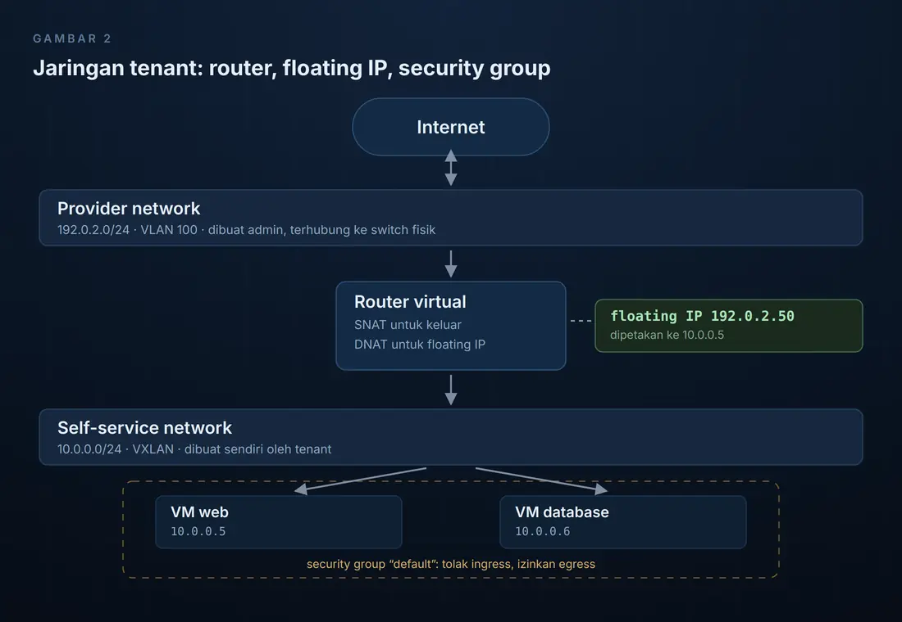

> **Ringkasan:** OpenStack adalah kumpulan layanan API yang mengubah kumpulan server, storage, dan jaringan menjadi cloud privat. Artikel ini memetakan komponen intinya, mengikuti satu permintaan dari `openstack server create` sampai VM menyala, lalu membahas kapan OpenStack benar-benar masuk akal dipakai.

Saat pertama kali membuka dashboard OpenStack, yang terasa bukan rumitnya, melainkan banyaknya menu. Compute, Network, Volume, Image, Identity, Orchestration — masing-masing punya halaman, istilah, dan dokumentasi sendiri.

Itu masuk akal, karena OpenStack memang bukan satu program. Ia kumpulan proyek yang masing-masing punya API, basis kode, dan tim pengembang. Dokumentasi resminya lengkap, tetapi tersebar per proyek. Yang jarang dijelaskan justru gambaran besarnya: layanan mana yang memutuskan, mana yang mengeksekusi, dan bagaimana semuanya tersambung.

Artikel ini mengisi bagian itu. Tidak ada langkah instalasi di sini; fokusnya konsep dan arsitektur. Prasyaratnya sederhana: Anda nyaman dengan Linux, pernah memakai virtualisasi (KVM, VMware, atau Proxmox), dan paham dasar jaringan seperti subnet, VLAN, dan NAT.

Setelah membaca, Anda seharusnya bisa melihat diagram arsitektur OpenStack dan tahu layanan mana yang menangani apa — termasuk mengapa sebuah VM bisa gagal dibuat walaupun kuota proyek masih tersedia.

## Daftar isi

- [Apa itu OpenStack](#apa-itu-openstack)
- [Masalah yang sebenarnya diselesaikan](#masalah-yang-sebenarnya-diselesaikan)
- [Arsitektur OpenStack: kontrol plane, compute plane, dan fabrik](#arsitektur-openstack-kontrol-plane-compute-plane-dan-fabrik)
- [Komponen inti OpenStack](#komponen-inti-openstack)
- [Alur satu permintaan menjadi VM](#alur-satu-permintaan-menjadi-vm)
- [Identitas dan isolasi antar-tenant](#identitas-dan-isolasi-antar-tenant)
- [Jaringan: bagian yang paling sering bikin pusing](#jaringan-bagian-yang-paling-sering-bikin-pusing)
- [Storage: empat jenis yang sering tertukar](#storage-empat-jenis-yang-sering-tertukar)
- [Istilah yang sering tertukar](#istilah-yang-sering-tertukar)
- [Deployment dan operasi sehari-hari](#deployment-dan-operasi-sehari-hari)
- [Masalah yang sering muncul](#masalah-yang-sering-muncul)
- [Kapan OpenStack masuk akal](#kapan-openstack-masuk-akal)
- [Alternatif yang jujur](#alternatif-yang-jujur)
- [Kesimpulan](#kesimpulan)
- [Referensi](#referensi)

## Apa itu OpenStack

OpenStack adalah kumpulan perangkat lunak open source yang bersama-sama menyediakan *Infrastructure as a Service* (IaaS): mesin virtual, jaringan virtual, volume disk, image, dan identitas — semuanya bisa dipesan lewat API.

[Situs resminya](https://www.openstack.org/software/) menyebutnya *cloud operating system*: lapisan yang mengendalikan kumpulan besar resource komputasi, penyimpanan, dan jaringan di seluruh data center, semuanya dikelola lewat API dengan mekanisme autentikasi yang sama. Istilah itu metafora yang berguna, bukan deskripsi teknis — OpenStack tidak menggantikan kernel dan tidak mem-boot hardware, ia mengoordinasikan resource yang sudah ada.

Proyeknya dimulai pada 2010, ketika NASA dan Rackspace menggabungkan dua upaya internal mereka, platform komputasi Nebula dan layanan penyimpanan objek Cloud Files, menjadi satu proyek bersama. Rilis pertama, Austin, keluar pada Oktober 2010. Sejak itu OpenStack dikembangkan terbuka dengan lisensi Apache 2.0 dan dikelola komunitas di bawah OpenInfra Foundation.

Yang perlu dipahami sejak awal: **OpenStack bukan hypervisor dan bukan distro.** Ia lapisan orkestrasi. Hypervisor-nya tetap KVM, VMware, atau bahkan bare metal lewat Ironic. Storage-nya tetap Ceph, LVM, atau NFS. OpenStack yang menyediakan API, kontrol akses, kuota, dan otomasi di atas semua itu.

Sejak 2013 OpenStack memakai model *big tent*: proyek tidak harus masuk daftar inti untuk dianggap bagian dari OpenStack. Hasilnya ada puluhan proyek dengan tingkat kematangan berbeda. Sebagian wajib ada di setiap cloud, sebagian hanya relevan untuk kebutuhan tertentu.

Rilisnya keluar setiap enam bulan dan diberi nama. Sejak 2023.1 formatnya berubah menjadi tahun.nomor plus nama kode. Per November 2026, rilis stabil terbaru adalah **2026.2 Hibiscus**.

| Rilis | Nama | Tanggal rilis |
|---|---|---|
| 2025.2 | Flamingo | 1 Okt 2025 |
| 2026.1 | Gazpacho (SLURP) | 1 Apr 2026 |
| 2026.2 | Hibiscus | 30 Sep 2026 |
| 2027.1 | Indri (SLURP) | ± 24 Mar 2027 |

Baris terakhir masih dalam pengembangan; sisanya sudah dirilis.

SLURP (*Skip Level Upgrade Release Process*) adalah penanda bahwa rilis tersebut boleh dijadikan titik lompat upgrade. Tanpa SLURP, upgrade harus berurutan dari satu rilis ke rilis berikutnya. Dengan SLURP, Anda boleh melewati satu rilis di antaranya, misalnya dari 2025.1 langsung ke 2026.1 tanpa mampir ke 2025.2.

## Masalah yang sebenarnya diselesaikan

Bayangkan Anda punya 40 server dan 200 TB storage. Tim developer ingin membuat lingkungan uji sendiri hari ini juga, tanpa menunggu tim infrastruktur. Kalau semua permintaan lewat tiket dan dikerjakan manual, Anda punya virtualisasi, bukan cloud.

Bedanya ada di tiga hal:

1. **API swalayan.** Developer memesan resource sendiri lewat CLI, dashboard, atau Terraform, tanpa manusia di tengah.
2. **Isolasi antar-tenant dengan kuota.** Dua tim bisa punya jaringan dengan subnet yang sama persis (misalnya `10.0.0.0/24`) tanpa saling tabrakan.
3. **Abstraksi resource yang konsisten.** Image, flavor, volume, dan jaringan punya arti yang sama di semua hypervisor dan backend storage.

Analogi "sistem operasi untuk data center" tadi berguna di satu hal: seperti sistem operasi membagi CPU dan memori ke proses, OpenStack membagi server, storage, dan jaringan ke tenant. Bedanya, OpenStack tidak berbicara langsung ke hardware — ia memanggil driver seperti libvirt, Ceph, atau Open vSwitch, dan driver itulah yang menyentuh perangkat.

## Arsitektur OpenStack: kontrol plane, compute plane, dan fabrik

Setiap diagram OpenStack yang berguna akan membagi dunia menjadi tiga bagian.

[](/img/openstack/arsitektur-openstack.webp)

*Gambar 1. Kontrol plane memutuskan, compute plane mengeksekusi, fabrik menyediakan jaringan dan storage. Angka 1–5 mengikuti alur di bagian berikutnya. Ketuk gambar untuk membuka ukuran penuh.*

**Kontrol plane** adalah otaknya. Di sinilah permintaan diterima, divalidasi, host dipilih, dan state disimpan. Isinya API service, scheduler, message queue (RabbitMQ), dan database (MariaDB/Galera).

**Compute plane** adalah ototnya. Ini host fisik yang menjalankan VM. Di setiap host ada `nova-compute`, agent jaringan, dan hypervisor.

**Fabrik** adalah tanah dan jalannya: switch, VLAN atau VXLAN, dan backend storage.

Pembagian ini punya konsekuensi operasional yang penting. Kontrol plane bisa mati beberapa menit tanpa mematikan VM yang sudah berjalan — hipervisornya tetap bekerja, yang berhenti hanya kemampuan membuat, menghapus, atau mengubah resource. Sebaliknya, compute node yang mati berarti VM di host itu ikut mati, kecuali Anda menyiapkan mekanisme evakuasi seperti Masakari.

Ada tiga jalur komunikasi yang perlu diingat:

- **Klien ke API:** HTTP/REST dengan token.
- **Layanan ke layanan:** RPC lewat RabbitMQ, dibungkus library `oslo.messaging`.
- **Layanan ke state:** SQL.

Karena API-nya *stateless*, Anda bisa menjalankan beberapa `nova-api` di belakang load balancer. RabbitMQ dan database tidak bisa diperlakukan begitu; keduanya harus di-cluster, dan di sinilah sebagian besar masalah produksi berasal.

## Komponen inti OpenStack

Ini layanan yang paling sering Anda temui di cloud OpenStack.

| Layanan | Proyek | Tugas |
|---|---|---|
| Identity | Keystone | Token dan katalog |
| Compute | Nova | VM dan hipervisor |
| Placement | Placement | Inventori host |
| Networking | Neutron | Jaringan virtual |
| Block Storage | Cinder | Volume blok |
| Image | Glance | Image disk |
| Dashboard | Horizon, Skyline | UI web |
| Object Storage | Swift | Objek via HTTP |
| Orchestration | Heat | Template HOT |

Enam baris pertama wajib ada di cloud produksi. Horizon praktis wajib karena jadi antarmuka sehari-hari, sedangkan Swift dan Heat baru diperlukan kalau Anda memang memakai penyimpanan objek atau template orkestrasi.

**Keystone** adalah pintu masuk semua layanan. Ia mengelola *domain*, *project*, *user*, dan *role*, lalu menerbitkan token. Setiap permintaan ke layanan lain harus membawa token yang valid, dan layanan itu memvalidasinya ke Keystone. Keystone juga menyimpan *service catalog*: daftar endpoint setiap layanan per region. Tanpa katalog ini, CLI tidak tahu harus menghubungi alamat mana.

**Nova** mengelola siklus hidup VM. Ia terpecah menjadi beberapa proses: `nova-api` menerima permintaan, `nova-scheduler` memilih host, `nova-conductor` menjembatani database dan mengoordinasikan operasi, dan `nova-compute` menjalankan perintah di host. Untuk skala besar, Nova memakai *cells* — sharding internal yang membagi database dan antrean agar satu cloud besar tidak bergantung pada satu database saja.

**Placement** dulu bagian dari Nova, lalu dipisahkan menjadi layanan sendiri sejak rilis Stein (2019). Tugasnya melacak inventaris resource tiap host — berapa vCPU dan RAM yang tersisa, apa saja *trait*-nya — dan memberi Nova daftar kandidat host. Pemisahan ini yang membuat penjadwalan bisa di-query tanpa membebani database Nova.

**Neutron** mengelola jaringan virtual: network, subnet, port, router, security group, dan floating IP. Ia memakai plugin ML2 dengan *mechanism driver* yang berbeda-beda, umumnya Open vSwitch (OVS) atau OVN. Neutron juga yang menyediakan DHCP dan layanan metadata di dalam instance.

**Cinder** menyediakan volume blok persisten. Volume bisa di-attach dan detach tanpa kehilangan data, di-snapshot, dan di-backup. Backend-nya bisa LVM, Ceph RBD, NFS, atau storage array komersial lewat driver.

**Glance** menyimpan image disk — biasanya format qcow2 atau raw. Saat VM dibuat, `nova-compute` mengunduh image dari Glance lalu menjadikannya disk dasar. Glance modern hanya menjalankan `glance-api`; layanan `glance-registry` lama sudah tidak dipakai.

**Swift** adalah penyimpanan objek dengan API HTTP, bukan filesystem yang di-mount. Isinya *account*, *container*, dan *object*, disebar memakai *ring* dan direplikasi antar-node. Swift juga menyediakan API yang kompatibel dengan S3 lewat middleware, jadi aplikasi yang sudah memakai SDK S3 bisa dipakai tanpa perubahan besar.

Proyek lain yang sering muncul di cloud nyata: **Ceilometer** dan **Gnocchi** (telemetri), **Ironic** (bare metal), **Octavia** (load balancer), **Barbican** (manajemen kunci), **Manila** (shared file system), **Magnum** (provisioning Kubernetes), dan **Designate** (DNS).

Peta resmi OpenInfra memperlihatkan ekosistem lengkapnya: bukan hanya layanan inti, tetapi juga alat klien, alat operasi, dan alat siklus hidup yang tidak masuk tabel di atas.

[](/img/openstack/peta-ekosistem.webp)

*Gambar 2. Peta ekosistem OpenStack versi 2026.04.01: layanan inti, alat klien, alat operasi, dan alat siklus hidup. Sumber: [OpenStack Map](https://www.openstack.org/openstack-map/), OpenInfra Foundation. Ketuk gambar untuk membuka ukuran penuh.*

## Alur satu permintaan menjadi VM

Ini bagian yang paling menjelaskan cara OpenStack bekerja. Perhatikan angka pada Gambar 1.

**1. Autentikasi.** CLI `openstack` membaca kredensial dari environment atau `clouds.yaml`, lalu meminta token ke Keystone. Jawabannya berisi token dan katalog endpoint.

**2. Permintaan diterima.** CLI memilih endpoint compute untuk region yang dituju dan mengirim `POST /servers` ke `nova-api`. Di sini Nova memvalidasi banyak hal: flavor ada, image bisa diakses, network ada, security group valid, dan kuota proyek mencukupi. Record VM dibuat di database dengan status `BUILD`.

**3. Penjadwalan.** `nova-scheduler` meminta kandidat host ke Placement, menyaring yang tidak layak (RAM tidak cukup, disk penuh, tidak berada di availability zone yang diminta), lalu memberi skor pada sisanya. Hasilnya satu host terpilih.

**4. Perintah dikirim.** `nova-conductor` mengirim perintah lewat RabbitMQ ke `nova-compute` di host terpilih. Di titik ini kontrol plane sudah selesai dengan tugasnya; eksekusi pindah ke compute plane.

**5. Eksekusi.** `nova-compute` meminta Neutron membuat port untuk VM, mengunduh image dari Glance (atau memakai cache lokal), menyiapkan disk, menulis definisi XML untuk libvirt, lalu menyalakan domain. Kalau VM memakai volume, Cinder yang menyambungkan volume tersebut.

**6. VM menyala.** Instance boot, `cloud-init` mengambil metadata dari `169.254.169.254` untuk mengatur hostname, SSH key, dan user-data. Status berubah dari `BUILD` ke `ACTIVE`, dan konsol tersedia lewat `nova-novncproxy`.

Perintahnya seperti ini. Output bergantung pada konfigurasi tiap cloud, jadi tidak saya tampilkan di sini.

```bash
openstack server create \
  --flavor m1.small \
  --image "Ubuntu 24.04" \
  --network private \
  --security-group default \
  --key-name kunci-saya \
  vm-uji
```

Untuk memeriksa hasilnya:

```bash
openstack server show vm-uji -c status -c addresses
```

Yang perlu diingat: kalau langkah 5 gagal di tengah jalan, VM tidak otomatis dibersihkan. Statusnya bisa tertinggal di `ERROR`, dan port atau volume yang sudah dibuat bisa tersisa. Inilah sebabnya kuota bisa "bocor" meski tidak ada VM yang berjalan. `openstack server delete` pada VM berstatus `ERROR` biasanya menyelesaikan sebagian besar kasus.

## Identitas dan isolasi antar-tenant

Keystone punya empat konsep yang saling terkait:

- **Domain** — kelompok tertinggi. Biasanya satu domain per organisasi atau pelanggan.
- **Project** — wadah resource dan kuota. Dulu disebut *tenant*, dan sebagian tool lama masih memakai istilah itu.
- **User** — akun yang melakukan autentikasi.
- **Role** — pemetaan hak akses, misalnya `member` atau `admin`.

Token yang diterbitkan Keystone selalu *scoped* ke satu project (atau ke domain untuk operasi administratif). Ini penting saat troubleshooting: banyak error "tidak diizinkan" ternyata bukan soal role, melainkan karena token yang dipakai scoped ke project yang salah.

Aturan siapa boleh melakukan apa disimpan di `policy.yaml` tiap layanan. Defaultnya cukup masuk akal, tetapi hampir setiap organisasi mengubahnya — misalnya melarang user biasa membuat provider network, atau membatasi siapa yang boleh melihat semua project.

## Jaringan: bagian yang paling sering bikin pusing

Kalau ada satu bagian OpenStack yang paling banyak menghabiskan waktu operator, itu Neutron. Bukan karena konsepnya sulit, tetapi karena ada dua dunia yang bertemu di situ: jaringan fisik dan jaringan virtual.

[](/img/openstack/topologi-jaringan-openstack.webp)

*Gambar 3. Dua jenis jaringan, satu router virtual, dan satu floating IP. Semua VM tetap memakai IP privat. Ketuk gambar untuk membuka ukuran penuh.*

Ada dua jenis jaringan yang perlu dibedakan:

**Provider network** terhubung langsung ke jaringan fisik data center, biasanya lewat VLAN. Performanya bagus dan sederhananya menyenangkan, tetapi hanya admin yang boleh membuatnya karena menyentuh infrastruktur nyata. Provider network juga tidak menyediakan router atau floating IP.

**Self-service network** sepenuhnya virtual, dibuat sendiri oleh tenant, dan biasanya memakai VXLAN sebagai overlay. Karena jumlah VXLAN bisa jauh lebih banyak daripada VLAN, setiap tenant bisa punya jaringan sendiri tanpa perlu koordinasi dengan tim jaringan.

Karena self-service network terisolasi, ia butuh **router virtual** untuk keluar. Router inilah yang melakukan SNAT untuk trafik keluar dan DNAT untuk *floating IP* — IP publik yang dipetakan satu-ke-satu ke IP privat instance. Tanpa floating IP, instance hanya bisa diakses dari dalam jaringan tenant.

Dua hal lain yang sering tertukar:

- **Port** adalah titik sambung tempat satu perangkat menempel ke jaringan. Setiap NIC instance adalah satu port, dan security group menempel di port, bukan di instance.
- **Security group** bersifat *stateful* dan default-nya menolak semua ingress sambil mengizinkan egress. Kalau Anda menghapus aturan egress default, instance kehilangan akses ke layanan metadata di `169.254.169.254`.

Di lapisan bawah, Neutron memakai plugin ML2 dengan dua driver yang paling umum: ML2/OVS dan ML2/OVN. Pada ML2/OVS, router dan DHCP berjalan sebagai *network namespace* di node khusus, sehingga trafik tenant melewati node itu. Pada ML2/OVN, fungsi L3 dan DHCP terdistribusi ke compute node, sehingga tidak ada node jaringan terpisah dan jalur trafiknya lebih pendek. Soal mana yang aktif, jangan menebak dari tahun rilis: [Kolla-Ansible](https://docs.openstack.org/kolla-ansible/2026.2/reference/networking/neutron.html), salah satu alat deployment yang paling banyak dipakai, masih menjadikan Open vSwitch sebagai default. OVN harus diaktifkan sendiri lewat `neutron_plugin_agent: "ovn"` di `globals.yml`.

## Storage: empat jenis yang sering tertukar

| Jenis | Data bertahan? | Dipakai untuk |
|---|---|---|
| Ephemeral | Tidak, ikut VM | Disk root |
| Block volume | Ya, mandiri | Database, disk data |
| Object | Ya, mandiri | Backup, aset statis |
| Shared file | Ya, mandiri | NFS banyak VM |

Perbedaan yang paling sering menimbulkan insiden adalah baris pertama dan kedua. Disk *ephemeral* adalah bagian dari VM: ia dibuat dari image saat boot dan ikut terhapus bersama VM. Volume Cinder hidup terpisah; ia bisa dilepas, dipasang ke VM lain, dan disimpan bertahun-tahun.

Karena itu, untuk apa pun yang datanya penting, boot dari volume (`--boot-from-volume`) atau pasang volume terpisah. Jangan mengandalkan disk ephemeral, sekalipun VM-nya jarang dihapus.

## Istilah yang sering tertukar

| Istilah | Arti | Sering disangka |
|---|---|---|
| Project | Wadah resource dan kuota | Sama dengan user |
| Region | Kumpulan endpoint API | Sama dengan data center |
| Availability zone | Pembagian logis region | Selalu beda ruangan |
| Cell | Sharding internal Nova | Terlihat oleh user |
| Flavor | Template vCPU, RAM, disk | Image |
| Image | Cetakan disk dasar | Snapshot volume |

Region dan availability zone sering dianggap sama karena keduanya terasa seperti "lokasi". Region adalah batas API: endpoint-nya berbeda, katalognya berbeda, dan biasanya VM tidak bisa dipindah antar-region tanpa proses sendiri. Availability zone adalah pembagian di dalam satu region, umumnya diimplementasikan lewat *host aggregate*, dan dipakai untuk menyebar VM agar tidak jatuh bersamaan saat satu rak mati.

Satu hal lagi yang perlu diluruskan: **OpenStack tidak punya high availability bawaan.** Ia menyediakan bahan-bahannya — database yang bisa di-cluster, API yang stateless, storage terdistribusi — tetapi Anda yang harus merancangnya. Cloud dengan satu controller dan satu database adalah *single point of failure*, bukan cloud yang tangguh.

## Deployment dan operasi sehari-hari

Tidak ada cara "resmi tunggal" untuk memasang OpenStack. Yang ada adalah beberapa alat dengan trade-off masing-masing:

- **Kolla-Ansible** — men-deploy setiap layanan sebagai container Docker, dikendalikan Ansible. Panduan deployment resmi rilis 2026.2 yang sudah terbit memakai jalur ini, dan mode *all-in-one*-nya cocok untuk lab.
- **OpenStack-Ansible** — men-deploy di container LXC atau langsung di bare metal, dengan pendekatan yang lebih tradisional.
- **Distro vendor** — Red Hat OpenStack Platform, Canonical, Mirantis, dan lainnya, lengkap dengan dukungan komersial.
- **DevStack** — skrip untuk lingkungan pengembangan. Jangan pernah dipakai di produksi.

Topologi minimum yang realistis untuk produksi kecil: tiga controller, minimal dua compute, tiga node Ceph, dan satu jaringan uplink yang benar. Untuk lab, [panduan quick start Kolla-Ansible](https://docs.openstack.org/kolla-ansible/2026.2/user/quickstart.html) menyebut kebutuhan minimum 8 GB RAM, 40 GB disk, dan dua antarmuka jaringan. Kalau OpenStack-nya dijalankan di dalam VM, aktifkan *nested virtualization* — tanpa itu instance bisa dibuat tetapi tidak akan bisa boot. Semua layanan kontrol plane dijalankan di tiga controller dengan HAProxy dan keepalived di depannya, database di-cluster dengan Galera, dan RabbitMQ di-cluster.

Siklus hidupnya juga perlu dianggarkan. Rilis baru keluar setiap enam bulan, dan setiap rilis punya masa dukungan terbatas. Upgrade yang aman adalah dari N ke N+1, atau antar-SLURP bila ingin melompat. Melewati dua rilis non-SLURP berarti menempuh jalur upgrade yang tidak diuji komunitas.

Untuk operasi sehari-hari, tiga hal yang paling sering menyelamatkan:

1. **Backup database dan definisi RabbitMQ**, bukan hanya VM. Tanpa database, cloud tidak bisa direkonstruksi.
2. **Pantau kapasitas di Placement**, bukan hanya CPU host. Penjadwalan gagal karena inventaris, bukan karena grafik monitoring.
3. **Simpan konfigurasi di Git.** Konfigurasi Kolla atau OpenStack-Ansible adalah kode; perlakukan seperti kode. Kalau Git masih terasa asing, mulai dari [panduan Git dasar](/2020-10-22-mengenal-git/).

## Masalah yang sering muncul

Tiga gejala ini menjelaskan sebagian besar laporan dari pengguna baru. Sebelum menebak, pastikan dulu di lapisan mana masalahnya: permintaan yang tidak pernah sampai ke compute akan terlihat seperti masalah jaringan.

| Gejala | Penyebab dan cara mengecek |
|---|---|---|
| VM macet di `BUILD` atau `ERROR` | Scheduler tidak dapat host, atau image/network tidak valid. Cek `openstack server event list <id>` dan log `nova-compute`. |
| VM `ACTIVE` tetapi SSH gagal | Floating IP belum dipasang, atau security group menolak ingress. Cek `openstack floating ip list` dan `openstack security group rule list`. |
| Kuota penuh padahal VM sudah dihapus | Port atau volume yatim tertinggal dari operasi yang gagal. Cek `openstack port list` dan `openstack volume list`. |

Baris ketiga adalah penyebab paling sering dari kuota yang "bocor": resource dibuat sebelum VM gagal, lalu tidak ikut terhapus.

## Kapan OpenStack masuk akal

OpenStack bukan pilihan default untuk cloud privat. Ia masuk akal ketika beberapa kondisi ini terpenuhi bersamaan:

- Anda butuh **multi-tenant** dengan isolasi dan kuota, bukan sekadar beberapa VM.
- Ada **tim** yang bisa merawat Linux, jaringan, dan storage — minimal dua atau tiga orang, bukan satu orang sambilan.
- Skalanya cukup besar: puluhan host, bukan tiga.
- Ada alasan kuat untuk **on-premise**: kedaulatan data, regulasi, latensi, atau integrasi dengan jaringan yang sudah ada.
- Anda butuh **API**, bukan hanya antarmuka web.

Sebaliknya, OpenStack sering jadi pilihan yang salah ketika:

- Kebutuhannya hanya 5–10 VM untuk satu tim. Proxmox VE akan selesai dalam hitungan jam.
- Timnya belum punya pengalaman storage terdistribusi. Ceph bukan komponen yang bisa diabaikan.
- Beban kerjanya *container-first*. Kubernetes dengan KubeVirt lebih dekat ke kebutuhan itu.
- Anggarannya hanya untuk lisensi, bukan untuk orang. Biaya terbesar OpenStack adalah waktu manusia, bukan perangkat lunak.

## Alternatif yang jujur

**VMware vSphere** tetap paling matang untuk virtualisasi enterprise, dengan ekosistem dan dukungan yang luas. Setelah perubahan lisensi Broadcom, biayanya menjadi pertimbangan serius bagi banyak organisasi.

**Proxmox VE** adalah pilihan paling masuk akal untuk skala kecil dan menengah: cepat dipasang, mendukung KVM dan LXC, dan biaya dukungannya wajar. Yang tidak ia berikan adalah API multi-tenant selengkap OpenStack.

**Kubernetes dengan KubeVirt** cocok kalau organisasi sudah *container-first* dan hanya butuh VM sebagai pelengkap. Jika VM adalah produk utamanya, OpenStack masih lebih tepat.

**Public cloud** menghilangkan capex dan beban operasi, dengan imbalan biaya bulanan yang bisa membengkak dan ketergantungan pada satu penyedia. Untuk beban kerja yang stabil dan besar, cloud privat sering lebih murah — asal biaya SDM dihitung jujur.

## Kesimpulan

Empat hal yang paling perlu dibawa dari artikel ini:

1. **OpenStack adalah kumpulan layanan API**, bukan satu program. Memahami satu layanan berarti memahami satu bagian, bukan keseluruhan.
2. **Kontrol plane memutuskan, compute plane mengeksekusi.** Hampir semua masalah bisa dilacak ke salah satu dari keduanya.
3. **Keystone dan Neutron adalah dua tempat paling sering terjadi kesalahan.** Token yang salah scope dan security group yang terlalu ketat sering menjelaskan sebagian besar tiket dukungan.
4. **OpenStack menuntut tim, bukan hanya server.** Kalau tidak ada orang yang merawatnya, cloud privat akan menjadi beban.

Kalau ingin melanjutkan, urutan belajarnya sebaiknya tidak dimulai dari semua proyek sekaligus. Pasang Kolla-Ansible mode all-in-one di satu VM, lalu coba alur di atas: buat project, unggah image, buat jaringan, jalankan VM, pasang floating IP. Setelah itu baru masuk ke storage dan HA. Dua sumber yang paling berguna adalah [panduan instalasi resmi](https://docs.openstack.org/2026.2/install/) dan [dokumentasi arsitektur Nova](https://docs.openstack.org/nova/2026.2/admin/architecture.html).

Kalau Anda belum nyaman dengan konsep di baliknya, dua artikel lama di blog ini bisa jadi pemanasan: [dasar jaringan komputer](/2022-03-05-jaringan-komputer/) untuk subnet dan VLAN, serta [pengenalan SDN](/2020-11-10-pengenalan-sdn/) untuk memahami mengapa jaringan bisa dikelola lewat API.

## Referensi

- [What is OpenStack?](https://www.openstack.org/software/) — definisi resmi, peta layanan, dan tautan ke komponen, SDK, serta alat deployment.
- [OpenStack Releases](https://releases.openstack.org/) — daftar rilis, status dukungan, dan jadwal SLURP.
- [OpenStack Installation Guide 2026.2](https://docs.openstack.org/2026.2/install/) — panduan pemasangan per layanan.
- [Nova System Architecture](https://docs.openstack.org/nova/2026.2/admin/architecture.html) — komponen Nova dan peran masing-masing.
- [OpenStack Networking](https://docs.openstack.org/neutron/2026.2/admin/intro-os-networking.html) — provider network, self-service network, dan security group.
- [Deployment Guides 2026.2](https://docs.openstack.org/2026.2/deploy/) — metode deployment yang didokumentasikan resmi.
- [Neutron di Kolla-Ansible](https://docs.openstack.org/kolla-ansible/2026.2/reference/networking/neutron.html) — driver jaringan default dan cara mengaktifkan OVN.
- [OpenStack Map](https://www.openstack.org/openstack-map/) — peta ekosistem: layanan inti, alat klien, operasi, dan siklus hidup.
- [OpenStack Project Navigator](https://www.openstack.org/software/project-navigator/openstack-components) — daftar proyek dan statusnya.
