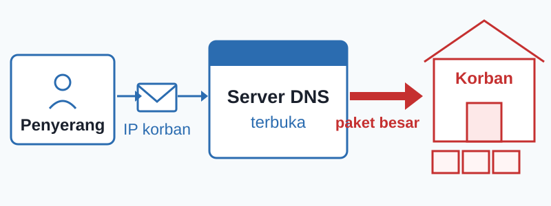
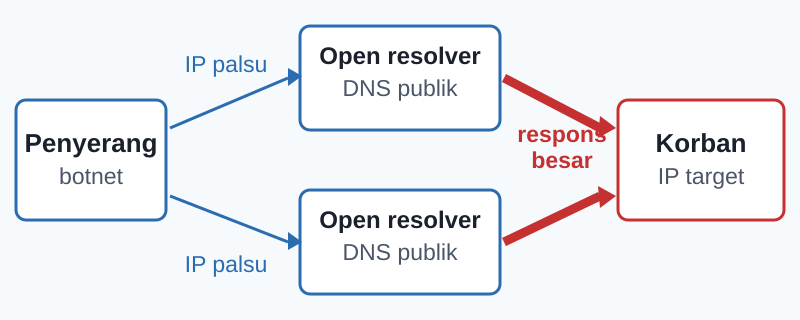

> **Ringkasan:** Bayangkan seseorang memesan seratus paket ke toko online, tetapi ia menulis nama dan alamat pengirimnya sebagai alamat rumah Anda. Toko mengira pesanan itu dari Anda, lalu mengirim semuanya ke rumah Anda. DNS amplification bekerja dengan cara serupa. Penyerang memakai alamat korban untuk memesan jawaban berukuran besar dari banyak server DNS sekaligus, sehingga korban dibanjiri data sampai layanannya tumbang. Artikel ini menjelaskan mekanismenya dengan bahasa sehari-hari, lalu menunjukkan cara mendeteksi dan mencegah server DNS Anda dipakai sebagai alat serangan.

## Siapa yang cocok membaca artikel ini

Anda tidak perlu bisa mengonfigurasi server untuk memahami artikel ini. Bagian awal memakai analogi sehari-hari dan tidak menuntut latar belakang teknis. Bagian yang berjudul **“Bagian teknis”** ditujukan untuk Anda yang mengelola server atau jaringan, dan boleh dilewati tanpa kehilangan inti penjelasan.

- Jika Anda pengguna internet biasa yang penasaran kenapa sebuah situs bisa tumbang tiba-tiba, cukup baca sampai bagian **“Siapa yang dirugikan”**.
- Jika Anda menyewa VPS (server sewaan), punya server pribadi, atau mengelola DNS, bagian teknis berisi langkah yang bisa langsung diperiksa.
- Jika Anda admin jaringan, semua bagian relevan, termasuk daftar referensi di akhir.

## Daftar isi

- [Siapa yang cocok membaca artikel ini](#siapa-yang-cocok-membaca-artikel-ini)
- [Cerita singkat: satu permintaan, ribuan paket](#cerita-singkat-satu-permintaan-ribuan-paket)
- [Apa itu DNS, dengan bahasa sehari-hari](#apa-itu-dns-dengan-bahasa-sehari-hari)
- [Kenapa namanya amplification](#kenapa-namanya-amplification)
- [Kenapa namanya reflection](#kenapa-namanya-reflection)
- [Cara kerja serangan langkah demi langkah](#cara-kerja-serangan-langkah-demi-langkah)
- [Istilah yang sering muncul](#istilah-yang-sering-muncul)
- [Siapa yang dirugikan](#siapa-yang-dirugikan)
- [Bagian teknis: mendeteksi serangan](#bagian-teknis-mendeteksi-serangan)
- [Bagian teknis: mencegah server Anda dipakai](#bagian-teknis-mencegah-server-anda-dipakai)
- [Batasan artikel ini](#batasan-artikel-ini)
- [Kesimpulan](#kesimpulan)
- [Referensi](#referensi)

## Cerita singkat: satu permintaan, ribuan paket

Bayangkan Anda tinggal di sebuah rumah. Suatu pagi, kurir datang membawa sepuluh paket besar. Siangnya datang lagi, lalu sore, lalu malam, dari puluhan toko berbeda. Semuanya beralamat ke rumah Anda dan mencantumkan nama Anda sebagai pemesan. Masalahnya, Anda tidak pernah memesan apa pun.

Rumah Anda akhirnya tidak bisa menerima tamu, tidak bisa menerima surat penting, dan halaman depan penuh tumpukan kardus. Bukan karena Anda melakukan kesalahan, tetapi karena ada orang lain yang memakai nama Anda untuk memesan barang dalam jumlah besar.

Di internet, “rumah” itu adalah sebuah server atau situs. “Paket” itu adalah data yang datang bertubi-tubi. Dan “orang yang memakai nama Anda” adalah penyerang yang memalsukan alamat IP korbannya. Inilah inti serangan DNS amplification: korban tidak diminta apa pun, tetapi dibanjiri jawaban.



*Gambar 1. Analogi serangan amplification dalam kehidupan sehari-hari (ilustrasi).*

## Apa itu DNS, dengan bahasa sehari-hari

Komputer di internet saling mengenali lewat deretan angka yang disebut alamat IP, misalnya `192.0.2.1`. Kalau dasar alamat IP masih terasa asing, ada [artikel IPv4](/2022-11-13-ip-versi-4/) yang membahasnya dari awal. Manusia lebih mudah mengingat nama, seperti `example.com`. DNS (*Domain Name System*) adalah penerjemah di antara keduanya. Ia seperti buku telepon: Anda menyebut nama, buku itu memberi nomor. Bagi yang baru mulai, [artikel jaringan komputer](/2022-03-05-jaringan-komputer/) menjelaskan konteks dasarnya.

Saat Anda membuka sebuah situs, perangkat Anda tidak menghubungi “buku telepon pusat” secara langsung. Ada beberapa peran yang bekerja berurutan.

1. **Perangkat Anda bertanya ke server DNS milik jaringan Anda.** Di rumah, ini biasanya server DNS dari penyedia internet. Di kantor, bisa jadi server DNS internal.
2. **Server itu mencari jawabannya.** Ia bisa bertanya ke server lain, mengikuti petunjuk satu per satu, sampai menemukan alamat IP yang benar. Server yang bertugas mencari seperti ini disebut **resolver rekursif**. Kata *rekursif* hanya berarti “mencari terus sampai ketemu”.
3. **Jawaban dikembalikan ke perangkat Anda.** Setelah alamat IP didapat, browser baru bisa membuka situs.

Ada satu lagi peran yang penting: **server autoritatif**. Ini server yang menyimpan data resmi sebuah domain. Kalau resolver adalah orang yang mencari ke banyak kantor, server autoritatif adalah kantor catatan sipil yang memegang data aslinya. Ia menjawab hanya untuk domain yang ia kelola.

Sekarang, bagian yang jadi akar masalah: **resolver terbuka** (*open resolver*). Ini server DNS yang melayani pertanyaan dari siapa saja di internet, bukan hanya dari pengguna jaringannya sendiri. Bayangkan resepsionis sebuah gedung yang bersedia mencarikan alamat untuk semua orang yang menelepon dari jalan, tanpa menanyakan siapa mereka. Niatnya membantu, tetapi siapa pun bisa memanfaatkannya.

Mengapa ada server yang terbuka? Sebagian karena pengaturan bawaannya memang menerima semua pertanyaan, sebagian karena pemiliknya sengaja membukanya agar bisa diakses dari mana saja tanpa menyadari risikonya. Server seperti ini tidak rusak atau terinfeksi; ia hanya terlalu ramah.

## Kenapa namanya amplification

*Amplification* berarti pembesaran; dalam bahasa Indonesia istilah ini sering ditulis **amplifikasi DNS**. Dalam konteks ini, satu pertanyaan kecil dijawab dengan jawaban yang jauh lebih besar.

Kembali ke analogi buku telepon: Anda bertanya, “Siapa saja yang tinggal di rumah ini?” Pertanyaan itu hanya satu kalimat. Jawabannya bisa berupa daftar panjang berisi nama, nomor, dan keterangan lain, jauh lebih tebal daripada pertanyaannya. Penyerang memanfaatkan ketidakseimbangan ini.

Secara teknis, pertanyaan DNS berukuran puluhan byte, sedangkan jawabannya bisa mencapai beberapa kilobyte. (Satu byte kira-kira sebesar satu huruf; satu kilobyte sekitar seribu byte.) Artinya, penyerang yang hanya mengirim data sedikit bisa memancing data jauh lebih banyak ke arah korban. Angka pastinya bergantung pada jenis data yang diminta dan konfigurasi server, jadi angka di artikel ini hanya ilustrasi.

| Yang dikirim penyerang | Yang diterima korban |
|---|---|
| Satu pertanyaan kecil, puluhan byte | Satu jawaban besar, bisa ribuan byte |
| Dikirim ke satu server DNS | Dikirim oleh banyak server DNS sekaligus |
| Biaya bandwidth kecil | Biaya bandwidth besar |

**Apa itu bandwidth?** Bayangkan koneksi internet sebagai pipa air. *Bandwidth* adalah lebar pipa itu: seberapa banyak data yang bisa mengalir setiap detik. Serangan ini mengisi pipa dengan data yang tidak diminta siapa pun. Pipa penuh, sehingga data yang Anda butuhkan tidak kebagian tempat.

Perhatikan baris kedua pada tabel. Amplifikasi tidak hanya soal satu jawaban yang besar, tetapi juga soal **jumlah**. Jika satu server bisa membalas puluhan kali lipat, dan penyerang memancing ratusan server sekaligus, korban menerima limpahan yang jauh melampaui kemampuan jaringannya.

## Kenapa namanya reflection

*Reflection* berarti pemantulan. Serangan ini tidak datang langsung dari komputer penyerang ke korban. Penyerang “memantulkan” serangan lewat pihak ketiga, yaitu server DNS yang tidak bersalah.

Caranya dengan memalsukan alamat pengirim. Di dunia nyata, ini seperti mengirim surat pesanan ke seratus toko, tetapi di kolom pengirim Anda menulis nama dan alamat tetangga. Toko tentu mengirim balasan dan barang ke tetangga itu, bukan ke Anda. Anda tidak perlu menerima apa pun, tidak perlu menanggung biaya kirim, dan bisa mengulanginya sesuka hati.

Di jaringan, trik ini disebut **IP spoofing**: penyerang menuliskan alamat IP korban di kolom “pengirim” pada paket data. Server DNS yang menerima paket itu tidak punya alasan meragukannya, karena UDP, cara komunikasi yang dipakai layanan DNS, memang tidak punya proses saling memverifikasi seperti jabat tangan. Server langsung mengirim jawabannya ke alamat yang tertera, yaitu alamat korban.

Dua nama itulah yang menjelaskan mengapa serangan ini disebut **DNS amplification and reflection**: memantulkan lewat server DNS, sekaligus memperbesar volumenya.

## Cara kerja serangan langkah demi langkah

Setelah dua istilah tadi dipahami, alurnya menjadi sederhana.

1. **Penyerang menyiapkan pertanyaan kecil dengan alamat pengirim palsu.** Ia menulis alamat IP korban sebagai sumber pertanyaan, lalu mengirimkannya ke server DNS yang terbuka untuk umum.
2. **Server DNS menerima dan percaya.** Karena alamat pengirimnya tertulis milik korban, server mengira korban yang bertanya. Server mulai menyiapkan jawaban, yang ukurannya jauh lebih besar daripada pertanyaannya.
3. **Jawaban dikirim ke korban.** Server mengirim paket jawaban ke alamat yang tertera, yaitu alamat korban. Penyerang tidak menerima apa pun, sehingga jejaknya lebih sulit dilihat dari sisi korban.
4. **Korban kebanjiran.** Penyerang mengulangi langkah 1 sampai 3 dari banyak server DNS sekaligus, sering kali lewat jaringan komputer yang sudah dibajak (*botnet*). Bandwidth korban penuh, server kehabisan tenaga, dan layanan berhenti merespons pengguna sungguhan.



*Gambar 2. Alur teknis serangan DNS amplification (ilustrasi konseptual).*

Salah satu cara klasik adalah meminta “semua data sekaligus” dengan satu jenis pertanyaan bernama `ANY`. Banyak operator kini menolak permintaan semacam itu (lihat RFC 8482), jadi penyerang beralih ke jenis data lain yang tetap menghasilkan jawaban besar, misalnya `TXT` atau jawaban yang disertai tanda tangan keamanan DNSSEC.

Yang membuat serangan ini sulit ditangkal: jawaban yang sampai ke korban adalah data DNS yang sah, dari server yang sah pula. Memblokir seluruh trafik DNS berarti ikut memutus hal yang normal, seperti memblokir semua kiriman paket karena ada satu pengirim nakal. Selain resolver terbuka, server autoritatif yang salah konfigurasi juga bisa dipakai, meski dampaknya lebih kecil karena ia hanya menjawab untuk domainnya sendiri.

## Istilah yang sering muncul

Tabel ini bisa Anda buka lagi saat membaca artikel lain tentang topik yang sama.

| Istilah | Arti sederhana |
|---|---|
| DNS | Penerjemah nama situs menjadi alamat IP, seperti buku telepon internet |
| Resolver rekursif | Server yang bertugas mencari alamat sampai ketemu |
| Server autoritatif | Server yang menyimpan data resmi sebuah domain |
| Resolver terbuka (*open resolver*) | Server DNS yang mau melayani siapa saja di internet |
| IP spoofing | Memalsukan alamat pengirim pada paket data |
| Amplification | Memperbesar: pertanyaan kecil, jawaban besar |
| Reflection | Memantulkan serangan lewat server pihak ketiga |
| DDoS | Serangan yang membuat layanan tumbang karena dibanjiri permintaan dari banyak sumber |
| UDP dan port 53 | Cara bicara dan nomor “pintu” yang dipakai layanan DNS |

## Siapa yang dirugikan

Serangan ini punya tiga kelompok korban, dan tidak semuanya terlihat jelas.

**Korban langsung** adalah pemilik situs atau layanan yang dibanjiri. Situsnya lambat atau tidak bisa dibuka, pengguna berpindah ke tempat lain, dan pemilik usaha kehilangan penjualan. Pada layanan yang menagih berdasarkan pemakaian bandwidth, tagihannya bisa melonjak dalam hitungan jam.

**Pemilik server DNS yang disalahgunakan** juga dirugikan, meski ia bukan target. Alamat IP servernya muncul sebagai sumber serangan, sehingga bisa masuk daftar hitam, diblokir penyedia lain, atau dicap sebagai sumber spam. Banyak pemilik server tidak sadar servernya dipakai, karena servernya tetap bekerja normal.

**Pengguna internet lain** ikut menanggung dampaknya. Trafik serangan memenuhi jalur jaringan, sehingga koneksi di sekitar situ melambat. Biaya penanganan juga akhirnya masuk ke tagihan layanan yang dibayar semua orang.

## Bagian teknis: mendeteksi serangan

Bagian ini untuk Anda yang mengelola server atau jaringan. Jika bukan, Anda boleh langsung ke bagian kesimpulan.

Tanda-tanda yang bisa dipantau:

- **Lonjakan trafik UDP/53.** Volume paket DNS naik drastis dalam waktu singkat, sering kali puluhan kali lipat dari kondisi normal.
- **Jawaban tanpa pertanyaan.** Paket jawaban DNS berukuran besar mengalir ke sebuah target, padahal target itu tidak pernah mengirim pertanyaan. Inilah indikator paling khas menurut CISA.
- **Sumber yang tersebar.** Trafik tampak berasal dari banyak server DNS publik, bukan dari satu alamat.

Contoh perintah untuk melihat trafik DNS di antarmuka `eth0` (jalankan di server atau di titik sadap jaringan Anda):

```bash
sudo tcpdump -nn -i eth0 'udp port 53' -c 20
```

Contoh output yang mungkin muncul (ilustrasi, bukan hasil eksekusi):

```text
10:12:01.123456 IP 203.0.113.10.53 > 198.51.100.5.12345: 12345 1/0/1 (4096)
10:12:01.124001 IP 198.51.100.9.53 > 198.51.100.5.12345: 12346 1/0/1 (4096)
```

Angka `4096` di ujung baris adalah ukuran paket dalam byte. Paket sebesar itu untuk jawaban DNS termasuk besar, dan itulah yang perlu Anda curigai ketika datang bertubi-tubi.

Contoh log dari firewall atau router (format bergantung perangkat):

```text
src=203.0.113.10 dst=198.51.100.5 proto=udp sport=53 dport=12345 bytes=4096
src=198.51.100.9 dst=198.51.100.5 proto=udp sport=53 dport=12345 bytes=4096
```

Gunakan data ini untuk membangun *baseline*: catat seperti apa trafik normal di jam sibuk, lalu pasang peringatan ketika angkanya melampaui batas wajar.

## Bagian teknis: mencegah server Anda dipakai

Sebelum menambal, pastikan dulu apakah resolver Anda memang menerima pertanyaan dari luar. Jalankan pengujian dari jaringan **luar**, bukan dari dalam jaringan lokal:

```bash
dig @203.0.113.10 example.com A +short
```

Ganti `203.0.113.10` dengan alamat IP publik server DNS Anda. Jika perintah itu mengembalikan alamat IP, server Anda melayani siapa saja. Jika jawabannya `REFUSED` atau berakhir dengan *connection timed out*, rekursi dari luar sudah tertutup.

Ujilah dengan domain milik orang lain, bukan domain Anda sendiri. Server autoritatif memang harus menjawab untuk zonanya sendiri; yang berbahaya adalah ketika ia ikut mencari alamat untuk domain lain.

### Batasi siapa yang boleh bertanya

Pada BIND (server DNS yang paling banyak dipakai di Linux), batasi rekursi hanya untuk jaringan internal:

```text
// Contoh (ilustrasi) — konfigurasi BIND untuk resolver internal
acl "internal" { 10.0.0.0/8; 192.168.0.0/16; };

options {
    recursion yes;
    allow-query     { internal; };
    allow-recursion { internal; };
};
```

Jika server yang sama juga harus menjawab domain publiknya sendiri, biarkan `allow-query` terbuka dan batasi hanya `allow-recursion`. Yang berbahaya adalah rekursi terbuka, bukan pertanyaan ke domain sendiri.

Pada server yang hanya autoritatif dan tidak perlu rekursi, matikan rekursi sepenuhnya:

```text
// Contoh (ilustrasi) — server autoritatif tanpa rekursi
options {
    recursion no;
    allow-query-cache { none; };
};
```

### Batasi laju jawaban

Response Rate Limiting (RRL) membatasi berapa banyak jawaban yang dikirim ke satu alamat dalam satu detik. Tujuannya bukan menolak pertanyaan, tetapi mencegah server dipakai sebagai penguat massal. RRL dirancang untuk server autoritatif yang memang melayani publik; memasangnya di resolver rekursif bisa mengganggu kinerja.

```text
// Contoh (ilustrasi) — parameter RRL di BIND
rate-limit {
    responses-per-second 10;
    window 5;
    slip 2;
};
```

### Tolak paket dengan alamat sumber palsu

BCP38 (RFC 2827) adalah praktik bagi penyedia jaringan untuk memeriksa paket yang masuk: alamat pengirimnya harus sesuai dengan jaringan asalnya. Jika tidak sesuai, paket dibuang. Tanpa alamat palsu, serangan reflection kehilangan bahan bakarnya.

Di Linux, pemeriksaan serupa bisa diaktifkan pada host:

```bash
# Contoh (ilustrasi) — mengaktifkan reverse path filtering di Linux
sysctl -w net.ipv4.conf.all.rp_filter=1
sysctl -w net.ipv4.conf.default.rp_filter=1
```

Nilai `1` berarti mode ketat. Uji dulu di lingkungan non-produksi: pada jaringan dengan jalur asimetris, mode ketat bisa membuang paket yang sebenarnya sah.

### Serap sisa serangan

*Scrubbing* adalah pembersihan trafik di pusat khusus: paket mencurigakan dibuang sebelum mencapai server tujuan. *Anycast* menyiarkan satu alamat IP dari banyak lokasi, sehingga trafik serangan tersebar dan tidak menumpuk di satu titik. Keduanya tidak mencegah amplifikasi, tetapi menahan dampaknya ketika cara lain tidak cukup.

Semua contoh konfigurasi di atas adalah ilustrasi, bukan hasil uji. Sesuaikan dengan kapasitas, susunan jaringan, dan kebijakan keamanan Anda.

## Batasan artikel ini

- **Cakupan.** Artikel ini menjelaskan mekanisme, cara mendeteksi, dan pendekatan mitigasi. Topik lanjutan seperti penalaan kernel, pengerasan resolver, atau desain DNS skala besar tidak dibahas.
- **Tidak ada langkah eksploitasi.** Tidak ada perintah atau skrip yang bisa dipakai untuk melancarkan serangan. Contoh yang ada hanya untuk observasi dan pertahanan.
- **Konteks sangat menentukan.** Efektivitas setiap mitigasi bergantung pada susunan jaringan, perangkat, kebijakan penyedia internet, dan konfigurasi DNS Anda.
- **Angka bersifat ilustrasi.** Ukuran paket, faktor amplifikasi, dan ambang peringatan berbeda di setiap lingkungan. Ukur sendiri sebelum menetapkan angka.

## Kesimpulan

DNS amplification adalah serangan yang meminjam alamat korban untuk memesan jawaban DNS berukuran besar dari banyak server sekaligus. Dua kata kuncinya menjelaskan seluruh mekanisme: **amplification** (pertanyaan kecil, jawaban besar) dan **reflection** (serangan dipantulkan lewat server pihak ketiga). Yang membuatnya berbahaya adalah jawaban tersebut datang dari server yang sah, sehingga sulit dibedakan dari trafik normal.

Pencegahan paling mendasar bukan di sisi korban, melainkan di sisi server DNS: jangan biarkan resolver melayani siapa saja, batasi laju jawaban, dan tolak paket dengan alamat sumber palsu. Langkah berikutnya, periksa apakah server DNS Anda terbuka dengan perintah `dig` di atas, lalu terapkan satu per satu mitigasi yang relevan.

## Referensi

- [RFC 8482 — Providing Minimal-Sized Responses to DNS Queries That Have QTYPE=ANY](https://www.rfc-editor.org/rfc/rfc8482)
- [RFC 5358 — Preventing Use of Recursive Nameservers in Reflector Attacks](https://www.rfc-editor.org/rfc/rfc5358)
- [RFC 2827 / BCP 38 — Network Ingress Filtering: Defeating Denial of Service Attacks which employ IP Source Address Spoofing](https://www.rfc-editor.org/rfc/rfc2827)
- [US-CERT Alert TA13-088A — DNS Amplification Attacks (CISA)](https://www.cisa.gov/news-events/alerts/2013/03/29/dns-amplification-attacks)
- [Wikipedia — Denial-of-service attack (bagian Amplification)](https://en.wikipedia.org/wiki/Denial-of-service_attack)
