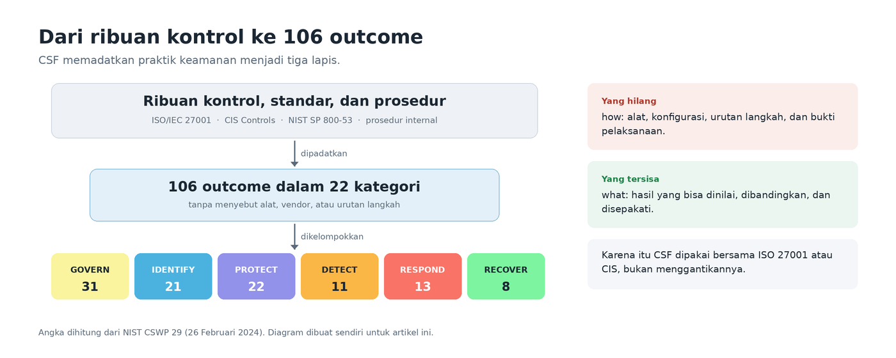
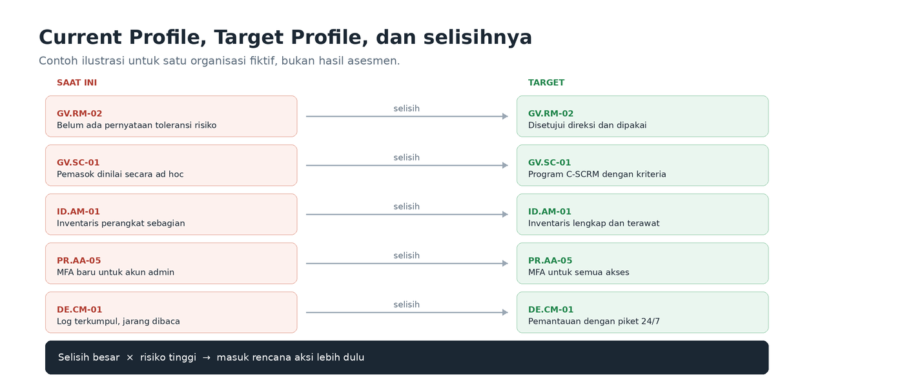

> **Ringkasan:** NIST Cybersecurity Framework 2.0 bukan daftar kontrol seperti ISO 27001. Ia kosakata hasil yang dipakai untuk menyepakati risiko, mengukur selisih antara kondisi sekarang dan target, lalu memprioritaskan pekerjaan. Artikel ini menjelaskan alasan desainnya, apa yang berubah dari versi 1.1, dan cara memakainya tanpa mengubahnya menjadi checklist.

Kalau Anda membuka dokumen NIST Cybersecurity Framework (CSF) 2.0 dan mencari daftar kontrol, Anda tidak akan menemukannya. Yang ada 106 pernyataan hasil, dan tidak satu pun menyebut alat, produk, atau nilai konfigurasi.

Itu bukan kelalaian. CSF dirancang sebagai bahasa bersama: untuk menyepakati risiko apa yang diterima, hasil apa yang ingin dicapai, dan seberapa jauh organisasi sekarang dari target itu. Dokumennya sendiri menyebut CSF sebagai taksonomi hasil, bukan kumpulan resep.

Artikel ini untuk praktisi IT atau keamanan yang sudah pernah mendengar CSF 2.0, mungkin diminta memakainya, tetapi belum tahu apa yang sebenarnya harus dikerjakan. Anda perlu paham dasar keamanan informasi; tidak perlu pernah menyusun profil atau mengikuti audit.

Yang dibahas: alasan bentuknya begitu, enam fungsi, Organizational Profile, Tier, posisinya terhadap ISO 27001, dan konteks Indonesia. Yang tidak dibahas: langkah audit, konfigurasi alat, dan pembacaan 106 butir satu per satu.

## Daftar isi

- [Kenapa CSF Berbentuk Begini](#kenapa-csf-berbentuk-begini)
- [Enam Fungsi dan Govern](#enam-fungsi-dan-govern)
- [Profil sebagai Inti Pemakaian](#profil-sebagai-inti-pemakaian)
- [Tier Bukan Tingkat Kematangan](#tier-bukan-tingkat-kematangan)
- [CSF dan ISO 27001](#csf-dan-iso-27001)
- [Konteks Indonesia](#konteks-indonesia)
- [Kesalahan Umum dan Batasan](#kesalahan-umum-dan-batasan)
- [Kesimpulan](#kesimpulan)
- [Referensi](#referensi)

## Kenapa CSF Berbentuk Begini

CSF lahir dari Executive Order 13636 pada Februari 2013. Infrastruktur kritis Amerika Serikat sebagian besar dimiliki swasta, dan pemerintah tidak punya kewenangan memerintahkannya. Karena itu perintah tersebut memilih jalur kemitraan dengan pemilik dan operator. Bagian 12(a) menegaskan order itu tidak menambah kewenangan regulasi baru bagi agensi mana pun.

Konsekuensinya, CSF bukan regulasi dan bukan standar yang bisa diaudit. Ia instrumen persuasi. Bagian 7(b) meminta pendekatan yang *prioritized, flexible, repeatable, performance-based*, dan *cost-effective*, ditambah syarat *technology neutral*. Yang paling menentukan: CSF harus memungkinkan sektor infrastruktur kritis mendapat manfaat dari pasar yang kompetitif. Kalau isinya daftar kontrol tertentu, ia mengunci pasar ke satu standar atau satu kelompok vendor. Karena itu isinya pernyataan hasil, bukan tindakan.

Dua sifat itu saling mengunci. CSF tidak bisa disertifikasi karena sertifikasi akan menjadi gerbang pasar, sementara NIST bukan regulator. FAQ resminya menyatakan NIST tidak menawarkan sertifikasi atau pengesahan, dan tidak ada rencana membangun program penilaian kesesuaian. NIST juga menegaskan CSF bukan checklist.

Yang menarik, pengguna justru meminta sebaliknya. Dalam RFI 2022, NIST menerima 134 respons, dan lebih dari 500 rujukan meminta panduan implementasi yang lebih detail. Permintaan itu bertabrakan dengan sifat non-preskriptif yang membuat CSF bertahan sepuluh tahun.

Resolusi konflik itulah keputusan arsitektur terpenting di versi 2.0. NIST tidak menambah isi Core. Ia memindahkan "bagaimana" ke luar Core: Implementation Examples yang bisa diperbarui daring, Informative References yang memetakan ke lebih dari 50 dokumen lain, Quick-Start Guides, dan templat profil. Core tetap 106 butir dan stabil; ekosistem di sekelilingnya yang tumbuh. Karena itu CSF 2.0 bukan satu berkas, melainkan satu dokumen plus layanan.

## Enam Fungsi dan Govern

Core CSF 2.0 terdiri dari 106 subkategori, dikelompokkan ke 22 kategori dan enam fungsi. Angka itu lebih kecil dari versi 1.1 yang punya 5 fungsi, 23 kategori, dan 108 subkategori, meskipun ada fungsi baru di dalamnya.

| Aspek | CSF 1.1 (2018) | CSF 2.0 (2024) |
|---|---|---|
| Fungsi | 5 | 6, tambah Govern |
| Kategori | 23 | 22 |
| Subkategori | 108 | 106 |
| Profil | Framework Profile | Organizational dan Community Profile |
| Tier | 4, tiga dimensi | 4, dua kolom |

Enam fungsi itu: Govern (mengatur), Identify (mengidentifikasi), Protect (melindungi), Detect (mendeteksi), Respond (menanggapi), dan Recover (memulihkan). Urutannya tidak menunjukkan tahapan proyek. Dokumennya menegaskan urutan Core tidak menyiratkan urutan pelaksanaan atau tingkat kepentingan.

Yang perlu dilihat justru angka di dalam Govern: 31 dari 106 subkategori, hampir 30% dari seluruh isi Core. Itu bukan penambahan biasa. Di versi 1.1, urusan tata kelola tersebar di dalam Identify, lewat `ID.GV`, `ID.BE`, dan `ID.RM`. NIST menilai susunan itu menciptakan tumpang tindih antara tata kelola risiko dan manajemen risiko, sehingga batas keduanya kabur.

Pemisahan itu mengubah siapa yang menjadi pembaca. `GV.RR-01` menempatkan pimpinan organisasi sebagai penanggung jawab risiko siber. `GV.RM-03` menuntut kegiatan dan hasil manajemen risiko siber masuk ke proses manajemen risiko enterprise. Ini bahasa direksi, bukan bahasa admin server. Fungsi Govern juga menyelaraskan CSF dengan AI Risk Management Framework dan Privacy Framework, yang sama-sama membuka dengan Govern.

*Gambar 1. CSF memadatkan praktik keamanan menjadi tiga lapis. Jumlah pada tiap fungsi dihitung dari CSWP 29. Diagram dibuat sendiri untuk artikel ini.*

### Kalau Anda datang dari versi 1.1

Banyak organisasi sudah punya profil berbasis 1.1. Nomor subkategori di 2.0 sengaja tidak berurutan rapat, dan celah nomor itu menandai butir yang dipindahkan. Beberapa perpindahan yang paling sering ditemui:

| CSF 1.1 | CSF 2.0 |
|---|---|
| `ID.BE` | `GV.OC` |
| `ID.GV` | `GV.PO`, `GV.RR`, `GV.OV`, dan `GV.OC-03` |
| `ID.RM` | `GV.RM` |
| `ID.SC` | `GV.SC` |
| `PR.AC` | `PR.AA` |
| `PR.MA` | `ID.AM-08` |
| `RS.RP` | `RS.MA` |
| `RS.IM`, `RC.IM` | `ID.IM` |

Perhatikan `ID.IM`: butir perbaikan yang dulu menempel pada respons dan pemulihan sekarang menjadi kategori tersendiri. Maknanya bergeser dari perbaikan setelah insiden menjadi perbaikan berkelanjutan. NIST menyediakan berkas crosswalk resmi untuk pemetaan penuh, jadi jangan menebak sendiri.

## Profil sebagai Inti Pemakaian

Core adalah kosakata. Kalimatnya disusun di *Organizational Profile*.

Profil menjelaskan postur keamanan organisasi dalam bahasa outcome tadi. Ada dua jenis: *Current Profile* yang mencatat apa yang sekarang dicapai dan bagaimana, serta *Target Profile* yang mencatat hasil yang dipilih dan diprioritaskan. Cakupan profil bisa disesuaikan: seluruh organisasi, satu sistem keuangan, atau satu ancaman seperti ransomware. Satu organisasi boleh punya beberapa profil.

Cakupan yang sempit membuat profil tetap berguna untuk hal kecil: satu unit kerja, satu layanan yang baru diluncurkan, atau satu persyaratan dari pelanggan.

Dokumen CSF 2.0 menggambarkan satu siklus pemakaian profil dalam lima langkah:

1. Tentukan cakupan profil dan asumsi yang mendasarinya.
2. Kumpulkan informasi: kebijakan, prioritas risiko, hasil analisis dampak bisnis, standar yang sudah diikuti, dan peran yang terlibat.
3. Susun profil, dengan mempertimbangkan implikasi risiko dari kondisi sekarang untuk menentukan target.
4. Analisis selisih antara Current dan Target, lalu buat rencana aksi berprioritas.
5. Jalankan rencana dan perbarui profil.

Langkah keempat adalah tempat nilai CSF keluar. Tanpa selisih yang diukur, 106 subkategori hanya menjadi daftar bacaan. Dengan selisih, pertanyaannya berubah dari "apakah kita sudah melakukan ini" menjadi "mana yang paling jauh, paling berisiko, dan paling mendesak".

Tabel berikut adalah contoh ilustrasi untuk satu organisasi fiktif, bukan hasil asesmen. Perhatikan bahwa kolom keadaan memakai bahasa sehari-hari, sedangkan subkategorinya tetap merujuk ke Core.

| Subkategori | Keadaan sekarang | Target | Selisih |
|---|---|---|---|
| `GV.RM-02` | Belum ada pernyataan toleransi risiko | Disetujui direksi dan dipakai | Besar |
| `GV.SC-01` | Pemasok dinilai secara ad hoc | Program C-SCRM dengan kriteria | Besar |
| `ID.AM-01` | Inventaris perangkat sebagian | Inventaris lengkap dan terawat | Sedang |
| `PR.AA-05` | MFA baru untuk akun admin | MFA untuk semua akses | Sedang |
| `DE.CM-01` | Log terkumpul, jarang dibaca | Pemantauan dengan piket 24/7 | Besar |

*Gambar 2. Current Profile, Target Profile, dan selisihnya. Angka dan keadaan di sini ilustrasi, bukan data asesmen nyata.*

Selain profil organisasi, ada *Community Profile*: baseline yang disusun untuk sekelompok organisasi dengan kepentingan sama, misalnya satu sektor atau satu jenis teknologi. Profil komunitas bisa dipakai sebagai titik awal Target Profile, lalu disesuaikan dengan risiko masing-masing.

## Tier Bukan Tingkat Kematangan

Tier sering dibaca sebagai skor kematangan: makin tinggi makin baik, dan targetnya Tier 4. Definisi resminya lain. Tier menggambarkan tingkat ketelitian tata kelola dan manajemen risiko siber, dari respons ad hoc sampai pendekatan yang adaptif dan terus membaik.

| Tier | Tata kelola risiko | Manajemen risiko |
|---|---|---|
| 1 Partial | Strategi diterapkan ad hoc, prioritas tidak berbasis tujuan | Kesadaran terbatas, penanganan kasus per kasus |
| 2 Risk Informed | Praktik disetujui manajemen, belum jadi kebijakan menyeluruh | Ada kesadaran, belum ada pendekatan organisasi |
| 3 Repeatable | Kebijakan formal, ditinjau, dan diperbarui berbasis risiko | Pendekatan menyeluruh, informasi dibagikan rutin |
| 4 Adaptive | Risiko siber dipantau seperti risiko keuangan, anggaran berbasis risiko | Praktik beradaptasi dari pembelajaran dan indikator prediktif |

Perhatikan susunan tabelnya. Di versi 1.1, Tier punya tiga dimensi: proses manajemen risiko, integrasi program, dan partisipasi eksternal. Di versi 2.0 tinggal dua kolom, tata kelola dan manajemen. Partisipasi eksternal tidak lagi menjadi dimensi sendiri, melainkan dilebur ke kalimat tentang pemasok di setiap tier. Perubahan itu mengikuti pemisahan Govern dari Identify.

NIST juga tidak menyarankan semua organisasi mengejar tier tertinggi. Dokumennya menyebut kenaikan tier didorong risiko atau mandat yang lebih besar, atau analisis biaya-manfaat yang menunjukkan perbaikan sepadan. Tier melengkapi metodologi manajemen risiko yang sudah ada, bukan menggantikannya.

Yang paling tegas: NIST tidak menjadikan Tier sebagai model kematangan. Dalam concept paper 2.0, mereka menyatakan tidak akan menyediakan model kematangan tersendiri untuk menilai outcome pada level fungsi, kategori, atau subkategori. Alasannya masuk akal. Begitu ada skor resmi, muncul industri penilaian semu dan fleksibilitas yang menjadi kekuatan CSF hilang.

## CSF dan ISO 27001

Pertanyaan yang paling sering muncul: kalau sudah punya ISO/IEC 27001, apakah CSF masih perlu?

| Aspek | NIST CSF 2.0 | ISO/IEC 27001 |
|---|---|---|
| Bentuk | Taksonomi outcome | Standar persyaratan |
| Isi | 106 pernyataan hasil | Persyaratan sistem manajemen dan kontrol di Lampiran A |
| Sertifikasi | Tidak ada | Ada, lewat lembaga sertifikasi |
| Satuan kerja | Profil dan Tier | Penilaian risiko dan pernyataan penerapan |
| Kekuatan | Bahasa bersama dan prioritas | Kontrol rinci dan jaminan pihak ketiga |

Keduanya menjawab pertanyaan berbeda. ISO 27001 memberi tahu kontrol apa yang harus ada dan bagaimana membuktikannya kepada auditor. CSF memberi tahu hasil apa yang penting dan seberapa jauh organisasi dari sana. Informative References CSF memetakan outcome ke kontrol ISO, jadi keduanya bisa dipakai bersama tanpa menyusun ulang semuanya.

Yang perlu diwaspadai justru klaim "CSF-aligned". Karena tidak ada sertifikasi, klaim itu tidak bisa diaudit. Ia bisa berarti apa saja, dari pemetaan serius sampai daftar fitur yang kebetulan mirip.

## Konteks Indonesia

Di Indonesia, CSF tidak menggantikan kewajiban hukum, tetapi bisa menjadi bahasa untuk mengaturnya.

UU Nomor 27 Tahun 2022 tentang Pelindungan Data Pribadi mewajibkan pengendali data melindungi dan memastikan keamanan data yang diproses, antara lain lewat penyusunan dan penerapan langkah teknis operasional, serta penentuan tingkat keamanan berdasarkan sifat dan risiko data. Kewajiban itu dekat dengan `PR.DS` dan `GV.RM`. Pasal 37 mewajibkan pengawasan terhadap setiap pihak yang terlibat dalam pemrosesan, dan itu bersinggungan langsung dengan `GV.SC`.

Selain itu ada PP Nomor 71 Tahun 2019 tentang Penyelenggaraan Sistem dan Transaksi Elektronik, yang mengatur kewajiban penyelenggara sistem elektronik, termasuk pengelolaan keamanan informasi. BSSN juga menyediakan Indeks KAMI sebagai alat evaluasi mandiri untuk keamanan informasi.

CSF berguna di lapisan atas ketiganya: ia menyediakan kosakata untuk menyusun prioritas ketika kewajiban berasal dari beberapa sumber sekaligus. Yang tidak boleh dilakukan adalah menganggap CSF sebagai bukti kepatuhan. Ia tidak menetapkan sanksi, tidak mengaudit, dan tidak menerbitkan sertifikat.

## Kesalahan Umum dan Batasan

Beberapa pola yang berulang di organisasi yang baru memakai CSF.

**Menjadikan 106 subkategori sebagai checklist.** Ini kesalahan paling umum. Daftar dicentang, persentase dihitung, lalu dilaporkan sebagai "kesiapan 68%". Angkanya terlihat rapi tetapi tidak menjawab pertanyaan yang penting: risiko mana yang turun.

**Tier sebagai pajangan.** Menetapkan target Tier 4 tanpa dasar risiko membuat program mengejar formalitas. Yang bertambah biasanya dokumen, bukan kemampuan mendeteksi atau memulihkan.

**Profil yang tidak diperbarui.** Profil adalah potret, bukan patung. Tanpa siklus pembaruan, ia berubah menjadi arsip yang tidak lagi menggambarkan kenyataan.

**Govern yang berhenti di kertas.** Kebijakan dan tabel peran mudah dibuat. Yang sulit adalah memastikan rapat risiko benar-benar membahas risiko siber, dan anggaran mengikuti prioritas yang disepakati.

**Klaim vendor tanpa bukti.** "CSF-aligned" bukan sertifikasi. Mintalah pemetaan yang bisa diperiksa, bukan logo.

Yang juga perlu jujur: CSF tidak memberi kontrol rinci, tidak menyediakan model pengukuran resmi, dan tidak memberikan jaminan kepada pihak ketiga. Ketiga hal itu harus datang dari standar lain, alat lain, atau kesepakatan lain.

## Kesimpulan

Nilai CSF 2.0 bukan pada 106 butirnya, melainkan pada selisih yang berhasil diukur dan disepakati. Core hanya kosakata; keputusan lahir saat Current dan Target Profile dibandingkan, lalu diberi prioritas.

Aturan praktisnya sederhana. Pakai CSF kalau Anda punya beberapa pemangku kepentingan yang perlu bahasa sama, sudah punya kontrol dari ISO 27001 atau CIS tetapi bingung memprioritaskan, dan perlu menunjukkan selisih kepada manajemen. Jangan mulai dari CSF kalau organisasi belum punya dasar kontrol sama sekali; susun dulu kontrolnya, baru pakai CSF untuk mengatur prioritas. Dan jangan pakai CSF kalau yang dibutuhkan adalah sertifikasi.

Langkah pertama yang realistis: ambil satu cakupan kecil, susun satu potong profil, dan ukur selisihnya. Dari situ percakapan tentang risiko, anggaran, dan tata kelola biasanya baru bisa dimulai.

Artikel ini bersifat konseptual dan tidak memuat hasil pengujian. Untuk penerapan, verifikasi setiap klaim ke dokumen resmi NIST dan peraturan yang berlaku.

## Referensi

- [NIST Cybersecurity Framework 2.0 (CSWP 29)](https://doi.org/10.6028/NIST.CSWP.29), dokumen utama artikel ini.
- [Halaman resmi NIST CSF](https://www.nist.gov/cyberframework), sumber pembaruan dan terjemahan.
- [FAQ NIST CSF](https://www.nist.gov/cyberframework/faqs), rujukan pernyataan tentang sertifikasi dan checklist.
- [CSF 2.0 Concept Paper](https://www.nist.gov/document/csf-20-concept-paper), alasan penambahan Govern dan penolakan model kematangan.
- [NIST SP 1301: Organizational Profiles](https://doi.org/10.6028/NIST.SP.1301), panduan menyusun profil.
- [NIST SP 1302: Tiers](https://doi.org/10.6028/NIST.SP.1302), panduan memakai Tier.
- [Executive Order 13636](https://obamawhitehouse.archives.gov/the-press-office/2013/02/12/executive-order-improving-critical-infrastructure-cybersecurity), asal mandat CSF.

Bacaan internal yang berkaitan: [DNS amplification DDoS](/2026-11-20-dns-amplification-ddos/) untuk gambaran ancaman yang mendasari fungsi Detect dan Respond.
