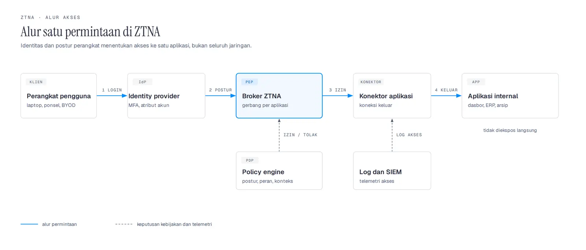

> **Ringkasan:** VPN memberi kepercayaan penuh begitu satu autentikasi lolos. ZTNA memecahnya menjadi keputusan per permintaan: identitas, postur perangkat, dan konteks dinilai ulang sebelum satu aplikasi dibuka. Ini penjelasan konsepnya menurut NIST SP 800-207, dari tujuh prinsip sampai titik lemahnya.

Seorang admin jaringan sedang di kafe dan perlu membuka dasbor monitoring yang ada di kantor. Dengan VPN, ia menekan tombol connect, menunggu tunnel terbentuk, lalu laptopnya mendapat alamat di subnet manajemen. Mulai saat itu tidak ada lagi yang membatasi ia membuka server lain di subnet yang sama, padahal hari itu ia hanya butuh satu halaman dasbor.

Model itu bukan kesalahan desain pada zamannya. Masalahnya, asumsi di belakangnya sudah tidak cocok dengan cara kerja hari ini. Aplikasi pindah ke cloud, perangkat dibawa ke kafe, dan kontraktor masuk dari jaringan yang tidak kita kendalikan. Penyerang yang mencuri satu kredensial langsung mendapat posisi nyaman untuk bergerak ke samping.

Artikel ini membahas ZTNA sebagai konsep, bukan panduan konfigurasi produk. Anda perlu paham dasar TCP/IP, firewall, dan VPN, tetapi tidak perlu memegang lisensi vendor. Konfigurasi perangkat dan perbandingan harga sengaja tidak dibahas.

## Daftar isi

- [Apa itu ZTNA?](#apa-itu-ztna)
- [Zero trust, ZTA, dan ZTNA: tiga istilah yang sering tertukar](#zero-trust-zta-dan-ztna-tiga-istilah-yang-sering-tertukar)
- [Tujuh prinsip dasar dari NIST](#tujuh-prinsip-dasar-dari-nist)
- [Dari perimeter ke identitas: apa yang berubah bagi admin](#dari-perimeter-ke-identitas-apa-yang-berubah-bagi-admin)
- [Cara kerja satu permintaan](#cara-kerja-satu-permintaan)
- [Lima komponen yang harus ada](#lima-komponen-yang-harus-ada)
- [Tiga cara membangun ZTNA dan kapan dipakai](#tiga-cara-membangun-ztna-dan-kapan-dipakai)
- [ZTNA versus VPN: yang berubah, bukan sekadar teknologi baru](#ztna-versus-vpn-yang-berubah-bukan-sekadar-teknologi-baru)
- [Contoh: satu permintaan yang ditolak](#contoh-satu-permintaan-yang-ditolak)
- [Harga yang dibayar: lisensi, latensi, dan titik buta](#harga-yang-dibayar-lisensi-latensi-dan-titik-buta)
- [Kesalahpahaman yang mahal](#kesalahpahaman-yang-mahal)
- [Pertanyaan umum](#pertanyaan-umum)
- [Kesimpulan](#kesimpulan)
- [Referensi](#referensi)

## Apa itu ZTNA?

ZTNA (*zero trust network access*) adalah cara memberi akses ke aplikasi berdasarkan identitas dan kondisi perangkat, bukan berdasarkan posisi di jaringan. Pengguna tidak lagi otomatis mendapat rute ke seluruh subnet internal. Ia mengautentikasi ke identity provider, perangkatnya diperiksa, lalu broker hanya meneruskan permintaan ke aplikasi yang diizinkan. Aplikasi tidak diekspos ke internet, dan pengguna tidak bisa melihat atau menghubungi server lain.

Analogi yang cukup akurat: VPN seperti satu gerbang utama dengan satu satpam. Setelah Anda masuk, Anda bebas berkeliling gedung. ZTNA seperti satpam di setiap pintu ruangan yang memeriksa kartu, wajah, dan jam kunjungan setiap kali Anda mau masuk. Prosedurnya memang lebih merepotkan, tetapi kerusakan akibat satu kartu hilang jauh lebih terbatas.

Satu hal yang sering keliru: ZTNA bukan standar resmi dan bukan nama arsitektur dalam NIST. NIST membahas *zero trust architecture* (ZTA) beserta komponennya, sedangkan ZTNA adalah istilah industri untuk satu kategori produk akses. Istilah ini dipakai vendor untuk hal yang kurang lebih sama, dengan batas yang tidak selalu konsisten.

## Zero trust, ZTA, dan ZTNA: tiga istilah yang sering tertukar

Perbedaan levelnya bukan soal semantik. Salah memahami tiga istilah ini membuat orang membeli alat untuk masalah yang sebenarnya bukan masalah alat.

*Zero trust* (ZT) adalah paradigma: kumpulan prinsip untuk merancang alur kerja, sistem, dan operasi. [NIST SP 800-207](https://csrc.nist.gov/pubs/sp/800/207/final) menyebutnya sebagai prinsip, bukan satu arsitektur tunggal, dan menegaskan bahwa transisi ke sana tidak bisa diselesaikan dengan mengganti teknologi secara borongan. Zero trust juga bukan produk yang bisa dibeli.

*Zero trust architecture* (ZTA) adalah arsitektur yang menerapkan prinsip itu. Di dalamnya ada komponen logis untuk memutuskan akses (policy engine dan policy administrator), menegakkan keputusan (policy enforcement point), dan mengevaluasi ulang saat sesi berjalan.

*ZTNA* adalah kategori akses jaringan, salah satu cara paling praktis mewujudkan ZTA. Ia menggantikan akses level-jaringan ala VPN dengan akses per aplikasi.

## Tujuh prinsip dasar dari NIST

NIST merumuskan tujuh tenet yang menjadi kompas desain. Saya menulisnya ulang dengan implikasi praktisnya.

1. **Semua data dan layanan adalah resource.** Bukan hanya server, tetapi juga bucket penyimpanan, API, dan akun layanan. Konsekuensinya, inventaris aset menjadi pekerjaan pertama, bukan pekerjaan terakhir.
2. **Semua komunikasi diamankan tanpa memandang lokasi.** Trafik dari LAN tidak boleh diperlakukan lebih longgar daripada trafik dari internet. Idealnya semua koneksi terenkripsi dan saling terautentikasi.
3. **Akses diberikan per sesi dengan hak minimum.** Izin ke satu aplikasi tidak otomatis membuka aplikasi lain. Sesi juga punya batas waktu, bukan berlaku selamanya.
4. **Keputusan akses memakai kebijakan dinamis.** Identitas, status perangkat, perilaku, waktu, dan lokasi ikut dihitung. Kebijakan statis berbasis subnet tidak cukup.
5. **Postur semua aset dipantau terus-menerus.** Perangkat yang belum di-patch atau kehilangan agen keamanan harus diperlakukan berbeda, termasuk ditolak.
6. **Autentikasi dan otorisasi dilakukan dinamis dan ditegakkan ketat.** Evaluasi tidak berhenti saat login. Sesi bisa ditinjau ulang ketika ada perubahan risiko.
7. **Telemetri dikumpulkan dan dipakai memperbaiki kebijakan.** Log akses, sinyal ancaman, dan perilaku pengguna menjadi umpan balik, bukan sekadar arsip.

Dua tenet yang paling sering terlewat adalah yang kelima dan ketujuh. Broker bisa dibeli, tetapi data postur perangkat dan log yang rapi tidak ikut dalam paket. Tanpa keduanya, keputusan akses kembali biner: kredensial benar berarti lolos.

## Dari perimeter ke identitas: apa yang berubah bagi admin

VPN bekerja di lapisan jaringan. Setelah autentikasi, klien mendapat alamat di subnet internal dan bisa mencoba menghubungi apa pun yang tidak diblokir firewall. ZTNA memindahkan titik kontrol ke lapisan aplikasi dan identitas, dan itu mengubah tiga hal dalam pekerjaan sehari-hari.

Pertama, jangkauan. Admin tidak lagi mendapat rute ke seluruh subnet, hanya ke satu aplikasi atau satu rute tertentu. Kedua, durasi kepercayaan. Sesi yang tadinya bertahan berjam-jam kini dievaluasi ulang, dan bisa diputus ketika perangkat berubah status. Ketiga, dasar keputusan. Pertanyaan "dari mana koneksinya" diganti "siapa, dengan perangkat apa, dalam kondisi apa".

Konsekuensi praktisnya terasa saat mencabut akses. Dengan VPN, mencabut satu pengguna berarti memutus tunnel, dan itu pun hanya efektif jika tunnelnya memang sedang aktif. Dengan ZTNA, yang dicabut adalah izin pada broker, dan permintaan berikutnya langsung ditolak.

Model lama tidak sepenuhnya salah. VPN masih masuk akal untuk akses site-to-site atau aplikasi internal yang seluruhnya dipercaya. Yang berubah adalah asumsi bahwa berada di dalam jaringan berarti boleh dipercaya.

## Cara kerja satu permintaan

Empat langkah berikut menjelaskan alurnya tanpa harus menyebut merek produk.

1. **Login.** Pengguna membuka aplikasi, diarahkan ke broker, lalu mengautentikasi ke identity provider, umumnya dengan MFA.
2. **Postur.** Agen di perangkat mengirim sinyal kondisi: versi OS, status enkripsi disk, keberadaan agen keamanan, dan patch terakhir. Pada mode clientless, sinyal ini terbatas pada yang bisa dilihat dari browser.
3. **Keputusan.** Policy engine menilai identitas, postur, perangkat, dan sinyal ancaman, lalu memilih izin, tolak, atau izin terbatas. Policy administrator menyiapkan jalur dan menerbitkan token sesi.
4. **Koneksi keluar.** Konektor di depan aplikasi membuka koneksi keluar, sementara broker terus memantau. Jika risiko berubah atau sesi kedaluwarsa, jalur ditutup.

Perhatikan pemisahan *control plane* dan *data plane*. Keputusan berjalan di jalur kontrol, data aplikasi mengalir di jalur data. Pemisahan inilah yang membuat pencabutan akses bisa dilakukan tanpa menyentuh jaringan fisik. Untuk konteks yang lebih dalam soal pemisahan ini, lihat [pengenalan Software Defined Network](/2020-11-10-pengenalan-sdn/).



*Gambar 1. Satu permintaan di ZTNA: identitas dan postur perangkat menentukan akses ke satu aplikasi, bukan seluruh jaringan. Diagram dibuat sendiri untuk artikel ini.*

## Lima komponen yang harus ada

Satu hal yang perlu ditegaskan lebih dulu: **broker tidak memutuskan**. Ia menegakkan keputusan yang dibuat policy engine. Dalam praktik, keduanya sering dijual sebagai satu layanan, dan itu wajar; yang penting Anda tahu mana yang sedang gagal ketika akses ditolak.

NIST memecah titik keputusan menjadi dua bagian: policy engine yang menilai, dan policy administrator yang mengeksekusi. Keduanya bersama-sama disebut *policy decision point* (PDP). Broker, gateway, atau agen di sisi klien adalah *policy enforcement point* (PEP), tempat keputusan itu terlihat oleh pengguna.

| Komponen | Peran | Istilah NIST | Catatan |
|---|---|---|---|
| Identity provider | Autentikasi pengguna dan MFA | ID management system | Menjadi titik kegagalan tunggal bila mati |
| Policy engine | Menilai permintaan, memilih izin atau tolak | Bagian dari PDP | Sebaiknya mencatat alasan keputusan |
| Policy administrator | Menyiapkan jalur dan token sesi | Bagian dari PDP | Sering menyatu dengan policy engine |
| Broker atau gateway | Menegakkan keputusan | PEP | Bisa terbelah menjadi agen klien dan gateway |
| Konektor aplikasi | Menghubungkan broker ke aplikasi | Bagian dari PEP | Umumnya koneksi keluar, tanpa buka port masuk |
| Telemetri dan SIEM | Menyimpan log dan sinyal risiko | Log dan SIEM | Tanpa ini, kebijakan tidak pernah membaik |

## Tiga cara membangun ZTNA dan kapan dipakai

Tidak semua ZTNA dibangun dengan cara yang sama. NIST menyebut tiga pendekatan yang dalam praktik sering digabung.

| Pendekatan | Cara kerja | Cocok untuk | Kelemahan |
|---|---|---|---|
| Identity governance | Kebijakan bertumpu pada identitas dan atributnya | Aplikasi SaaS dan cloud yang tidak bisa dipasangi komponen sendiri | Bergantung pada kualitas data identitas |
| Micro-segmentation | Gateway, firewall generasi baru, atau agen menjaga segmen kecil | Beban kerja sensitif di data center | Mahal bila perangkat penjaganya tidak terkelola |
| Software defined perimeter | Controller membentuk jalur lewat overlay, kanal terenkripsi | Akses pengguna ke aplikasi internal | Butuh agen, menambah hop dan latensi |

Tidak ada satu pendekatan yang menang. Organisasi yang matang biasanya memakai identitas sebagai basis kebijakan, micro-segmentation untuk beban kerja sensitif, dan SDP untuk akses pengguna. Yang perlu dihindari adalah memilih alat lebih dulu, lalu menyesuaikan arsitektur dengan alat itu.

## ZTNA versus VPN: yang berubah, bukan sekadar teknologi baru

| Aspek | VPN | ZTNA |
|---|---|---|
| Cakupan akses | Seluruh subnet internal | Satu aplikasi atau rute tertentu |
| Autentikasi | Sekali di awal sesi | Per sesi, dapat dievaluasi ulang |
| Postur perangkat | Jarang diperiksa, kecuali dengan NAC | Menjadi input keputusan |
| Pergerakan lateral | Mudah setelah tunnel terbentuk | Terbatas pada aplikasi yang diizinkan |
| Pengalaman pengguna | Satu klien, akses luas | Klien atau browser, akses terarah |
| Kompleksitas operasional | Relatif rendah | Lebih tinggi, butuh IdP dan inventaris |

Tabel ini menjelaskan biaya sebenarnya dari ZTNA. Yang dibeli bukan hanya produk, tetapi juga disiplin inventaris dan identitas yang selama ini bisa diabaikan karena subnet sudah dianggap aman.

## Contoh: satu permintaan yang ditolak

Bayangkan tim operasi jaringan perlu membuka dasbor internal di `203.0.113.10` dari rumah. Dengan VPN, mereka masuk ke subnet manajemen dan bisa mencoba alamat lain di subnet itu. Dengan ZTNA, broker hanya meneruskan permintaan ke satu aplikasi, dan keputusan bergantung pada identitas, perangkat, dan jam akses.

Contoh kebijakan konseptual berikut bukan format produk tertentu, hanya ilustrasi cara berpikirnya:

```yaml
# contoh kebijakan konseptual, bukan konfigurasi produk
application: "dashboard-jaringan"
allowed_groups: ["netops"]
require_mfa: true
require_posture:
  disk_encryption: true
  edr_running: true
  max_patch_age_days: 30
session:
  max_minutes: 30
  revoke_on_risk_change: true
```

Yang menarik justru jalur penolakannya. Jika laptop admin memakai disk tanpa enkripsi, permintaan berhenti di langkah tiga: policy engine menolak, dan yang tercatat adalah alasannya, bukan sekadar "ditolak". Log seperti ini yang membuat perbaikan mungkin dilakukan, karena admin tahu persis apa yang harus dibenahi.

Perhatikan juga bahwa tidak semua baris punya bobot sama. `application` bukan sinyal, ia hanya sasaran. Sinyal sebenarnya ada di `require_posture` dan `session`. Jika data postur perangkat tidak tersedia, dua blok terakhir hanya jadi hiasan.

## Harga yang dibayar: lisensi, latensi, dan titik buta

| Kelebihan | Kekurangan |
|---|---|
| Akses menyempit ke satu aplikasi, menekan pergerakan lateral | Biaya lisensi dan integrasi lebih tinggi dari VPN sederhana |
| Keputusan memakai identitas dan postur, bukan lokasi | Bergantung pada kematangan identity provider |
| Sesi bisa dicabut tanpa menyentuh jaringan | Menambah hop dan latensi, terutama untuk aplikasi berat |
| Log akses terpusat dan lebih kaya | Visibilitas trafik menyusut bila broker jadi satu-satunya jalur |

Biayanya tidak berhenti di lisensi. Ada biaya integrasi ke identity provider, biaya inventaris aplikasi, dan biaya perubahan proses: tim yang tadinya hanya mengurus aturan firewall kini juga mengurus kebijakan akses. ZTNA memindahkan kompleksitas, tidak menghilangkannya.

Ada juga titik buta yang perlu diakui. Ketika semua trafik melewati broker, tim kehilangan sebagian visibilitas jaringan yang dulu datang dari sensor dan span port. Log broker menjadi sumber utama, dan kualitas keputusan bergantung pada kelengkapan log itu.

## Kesalahpahaman yang mahal

**ZTNA bukan produk tunggal.** Ia butuh identity provider, inventaris perangkat, dan konektor yang dikelola. Membeli broker tanpa tiga hal itu biasanya berakhir dengan kebijakan longgar agar pengguna tidak mengeluh.

**Mode hybrid itu normal.** NIST mengakui mayoritas organisasi akan beroperasi sebagian dengan perimeter lama sambil bertransisi ([NIST SP 800-207](https://csrc.nist.gov/pubs/sp/800/207/final), §7.2). Menunggu sempurna sebelum mulai justru memperlambat perbaikan.

**ZTNA tidak menggantikan kontrol lain.** Patching, endpoint detection, segmentasi data center, dan manajemen akses tetap diperlukan. Zero trust mengatur siapa boleh lewat, bukan menjamin aplikasinya bebas celah.

**Perangkat lama dan OT menyulitkan.** Sistem yang tidak bisa menjalankan agen atau konektor sering harus diakses lewat enclave khusus dengan pengawasan tambahan. Ini kebutuhan nyata, bukan alasan menunda semuanya.

**Risiko baru muncul di titik pusat.** NIST mencatat bahwa policy engine dan policy administrator menjadi target bernilai tinggi ([NIST SP 800-207](https://csrc.nist.gov/pubs/sp/800/207/final), §5.1). Jika penyerang menguasai keduanya, seluruh kebijakan bisa dibengkokkan. Ketersediaan juga jadi risiko: matinya broker berarti matinya akses, dan itu perlu direncanakan sejak awal, bukan saat insiden.

## Pertanyaan umum

### Apa itu ZTNA dalam satu kalimat?

ZTNA adalah cara memberi akses ke aplikasi berdasarkan identitas dan konteks perangkat, tanpa menempatkan pengguna di dalam jaringan internal.

### Apa beda ZTNA dan VPN?

VPN memberi akses ke jaringan, ZTNA memberi akses ke aplikasi. VPN memercayai tunnel, ZTNA mengevaluasi setiap permintaan.

### Apakah zero trust itu produk?

Bukan. Zero trust adalah kumpulan prinsip. Produk hanya membantu menerapkannya, dan tidak otomatis membuat organisasi menjadi zero trust.

### Apakah jaringan kecil perlu ZTNA?

Tidak selalu. Jika semua pengguna ada di satu kantor dengan aplikasi internal terbatas, MFA dan segmentasi sederhana bisa lebih dulu memberi manfaat. ZTNA masuk akal ketika ada akses jarak jauh, banyak perangkat, dan beberapa aplikasi sensitif.

## Kesimpulan

ZTNA bukan alat ajaib, melainkan konsekuensi logis dari prinsip yang sudah lama diketahui: lokasi jaringan bukan bukti kepercayaan. Dengan memindahkan keputusan ke identitas dan konteks, akses menyempit, sesi menjadi pendek, dan pergerakan lateral kehilangan jalur mudah.

Yang perlu diingat, ZTNA hanya satu bagian dari ZTA. Ia tidak berarti apa-apa tanpa identity provider yang rapi, inventaris perangkat, dan telemetri yang benar-benar dibaca. Urutan yang lebih realistis:

1. Benahi identitas dan MFA lebih dulu.
2. Petakan aplikasi internal dan pemiliknya.
3. Jalankan satu aplikasi sebagai pilot, ukur penolakan dan keluhan pengguna, lalu perluas.

## Referensi

- [NIST SP 800-207: Zero Trust Architecture](https://csrc.nist.gov/pubs/sp/800/207/final), standar acuan utama artikel ini.
- [NIST SP 800-207A: ZTA untuk aplikasi cloud-native multi-cloud](https://csrc.nist.gov/pubs/sp/800/207/a/final), relevan untuk beban kerja Kubernetes dan service mesh.
- [CISA Zero Trust Maturity Model v2.0](https://www.cisa.gov/zero-trust-maturity-model), kerangka lima pilar dan tahap kematangan.
- [Google BeyondCorp: A New Approach to Enterprise Security](https://research.google/pubs/beyondcorp-a-new-approach-to-enterprise-security/), preseden praktis akses tanpa VPN.
- [NCSC UK: Zero Trust Architecture](https://www.ncsc.gov.uk/collection/zero-trust-architecture), panduan pemerintah Inggris yang menekankan perencanaan bertahap.
- [Fortinet: What Is ZTNA?](https://www.fortinet.com/resources/cyberglossary/what-is-ztna), contoh cara vendor memposisikan ZTNA. Berguna sebagai pembanding, bukan sebagai rujukan standar.

Bacaan internal yang berkaitan: [anatomi cloud privat dengan OpenStack](/2026-11-15-memahami-openstack-anatomi-cloud-privat/) untuk resource yang berada di luar jaringan sendiri, dan [DNS amplification DDoS](/2026-11-20-dns-amplification-ddos/) untuk gambaran ancaman yang mendasari asumsi "anggap jaringan sudah disusupi".
