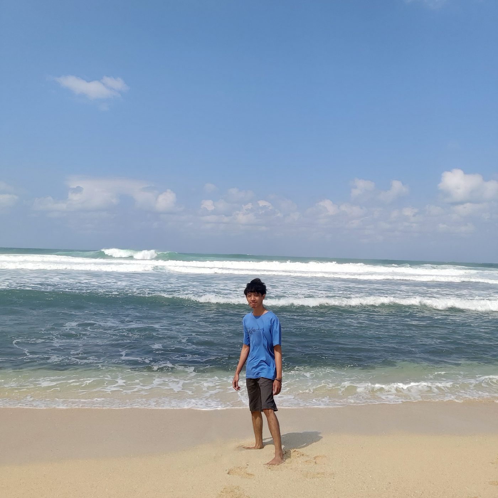

Halo, saya **Priyagung Elza Yogitama** — biasa dipanggil Yogi. Saya berasal dari Solo dan telah menyelesaikan studi magister (S2) Ilmu Forensik di Telkom University, Bandung, dengan fokus pada *cybersecurity* dan *digital forensics*.

Sebagian besar waktu kuliah saya habis di laboratorium jaringan dan sistem operasi: menjadi asisten praktikum, membantu operasional laboratorium, dan ikut study group. Dari situ saya belajar bahwa dokumentasi yang rapi sama pentingnya dengan konfigurasi yang benar — kebiasaan yang akhirnya saya bawa ke blog ini.

### Tesis

Tesis saya berjudul *Proactive Forensics for Online Exam Using Log Management Approach*. Intinya, saya membangun framework forensik proaktif untuk ujian daring: bukti digital (*Potential Digital Evidence*) dikumpulkan dan dikelola sejak ujian berjalan, bukan setelah insiden terjadi.

- Mengacu pada **NIST SP 800-92** untuk praktik *log management*.
- Menjaga integritas bukti dengan *hash*.
- Menganalisis anomali peserta memakai **Isolation Forest**, dengan akurasi 83% untuk indikasi anomali.
- Mengirim notifikasi otomatis ke proktor melalui dasbor berbasis web.

Tesis ini saya tulis untuk menyelesaikan studi S2 Ilmu Forensik di Telkom University (angkatan 2022). Abstrak dan detailnya bisa dilihat di [katalog Perpustakaan Telkom University](https://openlibrary.telkomuniversity.ac.id/pustaka/245184/proactive-forensics-for-online-exam-using-log-management-approach-dalam-bentuk-buku-karya-ilmiah.html).

### Pendidikan

- **S2 Ilmu Forensik**, Telkom University, Bandung — angkatan 2022.

### Pengalaman

- Asisten Laboratorium NetOS, Telkom University.
- Asisten Praktikum Jaringan Komputer (2019).
- Asisten Praktikum Sistem Jaringan Komputer (2020).
- Asisten Praktikum Pemrograman Web (2020).
- Study Group Network and Operating System Studio (2019).
- Study Group Access Network Laboratory (2018).
- Pemain tari Parama Budaya dan panitia Pagelaran Kecil UKM Djawa (2018).

### Sertifikasi

- **CompTIA Security+** — CompTIA (2023). Sertifikasi keamanan dasar yang mencakup ancaman dan kerentanan, kriptografi, arsitektur, operasi, serta manajemen risiko.
- **Fortinet Certified Fundamentals in Cybersecurity** — Fortinet (2023).

### Publikasi

- H. Nuha, E. Ariyanto, P. E. Yogitama, dan R. Wicaksono, "Modified Multipath Transmission Control Protocol Using Logarithmic Increase Under Long-Term Evolution and Wi-Fi Networks", *International Journal of Interdisciplinary Telecommunications and Networking*, 2022. [DOI: 10.4018/IJITN.311828](https://doi.org/10.4018/IJITN.311828)

### Keahlian

- **Digital forensics dan keamanan:** *log management*, NIST SP 800-92, CTF.
- **Jaringan:** Cisco Packet Tracer, OpenStack, dasar TCP/IP.
- **Sistem operasi:** Linux, Bash scripting.
- **Pemrograman:** Python 3, JavaScript (Node.js, Express, AdonisJS), Angular, Ionic.
- **Basis data:** MongoDB, MySQL, PostgreSQL.
- **Container:** Docker.

### Di luar pekerjaan

Saya menikmati CTF — [CTFtime](https://ctftime.org) adalah situs yang paling sering saya buka untuk latihan — dan senang menjelaskan hal teknis tentang jaringan serta sistem operasi ke orang lain. Blog ini adalah tempat saya mendokumentasikan catatan belajar itu.

### Kontak

- Email: [Priyagung.yoggi@gmail.com](mailto:Priyagung.yoggi@gmail.com)
- LinkedIn: [priyagung-yogi](https://www.linkedin.com/in/priyagung-yogi/)
- GitHub: [Yogiex](https://github.com/Yogiex)

Tautan sosial lain ada di footer.
